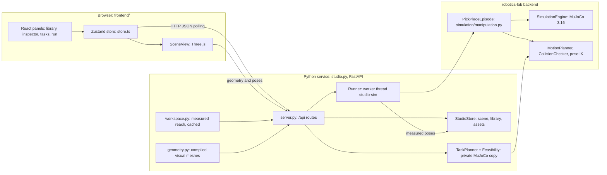

# Design Document

## Overview

ArmStrong is a browser front end and a small Python service over the robotics-lab MuJoCo backend. The browser
edits a scene (objects on a reach-sized table) and starts tasks. The service checks each task on a private copy
of the scene, turns it into moves, and runs every move as a physical `PickPlaceEpisode` on one worker thread. The
browser renders the robot and object poses the simulation streams back. The browser never computes motion.

## Architecture



Threading: HTTP handlers run in FastAPI's thread pool and only read copies or queue commands. The runner's
worker thread owns the live MuJoCo objects. Planner checks build their own scene copy per check.

## Components and Interfaces

### Service (`backend/robotics-lab/robotics-lab/studio/`)

| Module | Responsibility |
|---|---|
| `settings.py` | Loads `configs/studio.yaml` (extends `pick_place.yaml`), data and frontend paths |
| `robot.py` | Robot profile, payload and gripper rules (`lift_problems`, `shape_problems`), grasp options and depth |
| `reach.py` | `GraspProbe`: top-down pre-grasp/grasp poses with pose IK and the planner's collision rules; carry-arc check |
| `workspace.py` | Measures the work area per azimuth, derives the ring and table radius, caches by configuration key |
| `geometry.py` | Exports compiled visual geoms and meshes (binary blob) and body poses |
| `scene.py` | `StudioStore`: objects, library, uploaded assets, placement rules, JSON persistence, revisions |
| `planner.py` | Task catalog, decomposition into legs, rearrangement, swing splitting, feasibility, plain-language problems |
| `runner.py` | Worker thread: one episode per leg, wall-clock pacing, pause/stop/speed, settling, frames, failure messages |
| `server.py` | FastAPI routes and static hosting of `frontend/dist` |

### Backend extensions (opt-in through `configs/studio.yaml`)

- `simulation/engine.py`: free boxes added through `environment_overrides["objects"]`; body quaternions.
- `simulation/manipulation.py`: measured object pose, placement height and support bodies per case; configurable
  grasp width; fingertip clearance to supports; arc transport at constant grip orientation (`transport: arc`)
  with fallback to the joint-space planner; approach and pre-place postures filtered for the straight
  descent and lowering (`straight_line_postures`); optional `home` phase.
- `tasks/pick_place.py`: `CartesianSegment.plan_path` (constant-orientation polyline) and `carry_arc_points`.
- `planning/motion_planner.py`: `plan_to_position(accept=)` to reject goal postures.

### HTTP API

| Method and path | Purpose |
|---|---|
| `GET /api/health`, `GET /api/config` | Status; robot profile, work area, tasks, phases, limits |
| `GET /api/geometry`, `GET /api/geometry.bin` | Manifest and binary meshes of the robot and table |
| `GET /api/scene` | Objects with derived state, supports and problems |
| `POST /api/scene/objects`, `PATCH`/`DELETE /api/scene/objects/{id}` | Add, edit, remove objects |
| `POST /api/scene/reset`, `POST /api/scene/restore` | Sample layout or empty table; layout from before the last run |
| `GET`/`POST /api/library`, `DELETE /api/library/{id}` | Library items |
| `POST /api/assets?filename=`, `GET /api/assets/{id}` | Upload and fetch 3D model files |
| `POST /api/tasks/check`, `POST /api/tasks/run` | Pre-flight plan; start a run |
| `GET /api/state` | Run status, speed, latest frame (robot and object poses) |
| `POST /api/run/pause`, `resume`, `stop`, `dismiss`, `speed` | Run control |
| `POST /api/robot/reset` | Return the robot to rest (idle only) |

### Frontend (`frontend/src/`)

| Part | Responsibility |
|---|---|
| `api/` | Typed client and API types; `ApiError` carries the server's problems |
| `store.ts` | App state, polling (400 ms idle, 33 ms while live), actions, toasts |
| `three/SceneView.ts` | Renders robot meshes at streamed poses, objects (box or uploaded mesh), work area, plan arcs; drag, drop, picking |
| `three/robotModel.ts`, `three/meshAssets.ts` | Robot geometry from the binary blob; GLB/glTF/OBJ/STL loading and fitting |
| `components/` | Top bar, library panel, object inspector, task panel, run panel, upload and custom-box dialogs, toasts |
| `lib/geom.ts` | Client copy of placement and lift rules for instant feedback |

## Data Models

```text
World        table_height 0.75, table_radius 0.805, r_in 0.33, r_out 0.745, theta_max_deg 135
SceneObject  id, name, size [w, d, h] m, mass kg, color, asset_id?, mesh? {format, scale, up, offset},
             pos [x, y, z], quat [w, x, y, z], template_id?
             derived: yaw, tilt_deg, state (on_table | stacked | tipped | fallen | unsupported),
                      supports, supporting, problems, can_lift
Problem      code, message, hint, object_id?
Leg          object_id, purpose (move | buffer | via), label, from, to,
             grasp {yaw, width, depth, lift}, problems
TaskPlan     task_id, title, summary, ok, revision, legs, problems, check_s, estimated_s
Run          id, state (starting | running | paused | stopping | settling | succeeded | failed | stopped),
             leg_index, phase, sim_time, legs [status, result], failure, notices
Frame        seq, bodies {name: [x, y, z, qw, qx, qy, qz]}, objects {...}, gripper_width, live
```

## Key Flows

**Startup.** Load the cached work area (or measure it, about 3 minutes), build the store, export the geometry,
start the worker thread, and serve the built frontend.

**Editing.** The browser checks a spot instantly with `lib/geom.ts`, then sends the edit. The store applies the
authoritative rules and bumps the scene revision, which invalidates the last plan.

**Check and run.** `TaskPlanner.compose` turns a task into legs. `rearrange` orders moves and adds buffer legs to
break cycles. Swings over 110° are split into `via` legs with a put-down. For each leg, `Feasibility` picks a grip
orientation that works for the pick, the place, the lift and the carry arc, preferring wide joint margins. A
placement that leaves a neighbour without finger room is refused. `run` repeats the check and starts the runner
only if the plan is ok.

**Execution.** For each leg, the runner builds a fresh episode from the current scene (every object is a free
box), starting from the arm posture the previous leg ended in. It paces the simulation to the wall clock and
publishes frames. It writes the measured object poses back to the store after each leg. The last leg returns home.

## Error Handling

| Situation | Response |
|---|---|
| Invalid edit (work area, overlap, bad values) | HTTP 400 with a list of `Problem`s |
| Unknown id | HTTP 404 |
| Edit or start while a run is active | HTTP 409 |
| Upload larger than 30 MB | HTTP 413 |
| Task cannot run | `check` returns `ok: false` with problems; `run` returns HTTP 422 with the plan |
| Move fails or is stopped | `run.failure` {stage, reason, message, hint}; gripper opens, objects settle, measured poses kept, remaining moves skipped |
| Exception in the worker | The run is marked failed ("Internal error") and the worker keeps serving; startup errors appear in `/api/health` |
| Server unreachable | The UI shows Offline and retries |

## Testing Strategy

- `tests/test_studio.py` (13 tests): engine overrides, case overrides, lift rules, packaged work area against the
  configuration, zone derivation, placement rules, persistence and assets, footprint overlap, planner
  decomposition and refusals, geometry export, a physical move and stack through the runner, and the HTTP API on
  a free port.
- Existing robotics-lab suite (236 tests) after backend changes, to show the extensions are opt-in.
- `npm run build`: strict TypeScript typecheck and production build.
- Development checks: all six tasks run through the API (placement errors 0.2–3.4 mm); headless-Chrome checks of
  dragging, picking, uploads (OBJ, GLB) and full runs with no console errors.

## Design Decisions

| Decision | Reason (measured during development) |
|---|---|
| Round table, robot at the centre, table top at 0.75 m | The reach is a ring around the base; the table follows it |
| Payload 3.0 kg | Panda datasheet. A 3.0 kg box held and was placed; a 3.5 kg box slipped (simulated grip about 37 N) |
| Grip width at most 58 mm | Fingers open to 80 mm and must clear the object by 20 mm before retreating; a 60 mm carton failed the release check |
| Area behind the base excluded (±135°) | Reachable all around, but carrying across the back needs joint 1 beyond its ±166° range |
| Arc transport at constant grip orientation | Joint-space swings tilted the hand up to 24° and let 0.4 kg boxes slide 10 mm in the grip |
| Split swings over 110° | The constant-heading arc was feasible in 42/42 random moves up to 120° and in 15/28 between 120° and 180° |
| Approach postures filtered for the straight descent | A posture near a joint limit made a descent fail partway down |
| Neighbour room check | Placements that left no finger room made later picks impossible |
| Box proxies for uploads | A mesh alone defines no physical properties or grasp; boxes give reliable contact |
| Known world, no perception | Object poses come from the simulator in this version |
| HTTP polling | Simple and bounded; 33 ms while a run is live |
