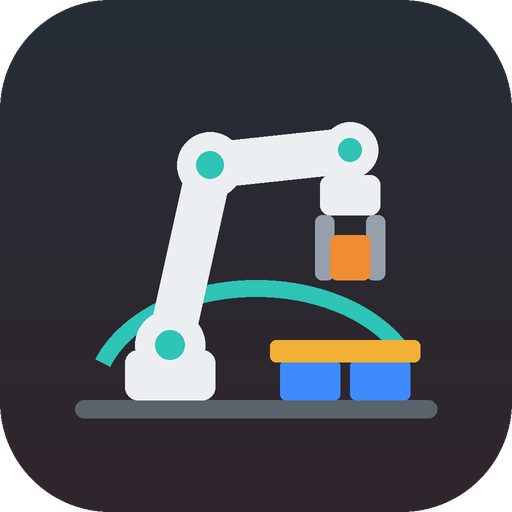
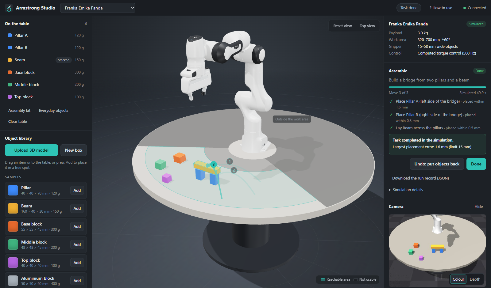

<p align="center">
  
</p>

<h1 align="center">Armstrong Studio</h1>

<p align="center">
  A simulated robot arm that <b>assembles</b>, stacks and sorts objects on a table, in your browser.<br>
  Real physics (MuJoCo), a Franka Emika Panda arm, and a 3D camera that finds the parts.
</p>



## Quick start (Windows 10/11)

1. **Download**: on this GitHub page press **Code → Download ZIP**, then unzip it anywhere (for example to your Desktop).
   Or use `git clone`.
2. **Start**: double-click **`Start.exe`** (the robot-arm icon) in the unzipped folder.
   `start.bat` does the same thing.
3. The **first start takes a few minutes**: it sets up a private Python environment inside the folder and downloads
   the simulation packages (about 200 MB). After that, starting takes a few seconds.
4. Your browser opens **Armstrong Studio** (`http://127.0.0.1:8765`). Keep the black window open while you use the
   app. Close it to stop.

> **"Windows protected your PC"?** `Start.exe` is a small unsigned launcher, so Windows SmartScreen may ask once.
> Click **More info → Run anyway**, or double-click `start.bat` instead. The launcher's source code is in
> [`launcher/Start.cs`](launcher/Start.cs).

**What you need:** a 64-bit Windows 10 or 11 PC, an internet connection for the first start, a normal graphics
driver (the simulated camera uses OpenGL) and a modern browser (Edge, Chrome or Firefox). Python is **optional**:
if Python 3.11 to 3.13 is installed it is used, otherwise the launcher downloads a private copy. Nothing is installed
system-wide, and deleting the folder removes everything.

## How to use it

The app shows a short guide on the first visit. You can reopen it any time with **? How to use** at the top.

1. **Set up the table.** The left panel lists the objects on the table. Drag items from the **Object library** onto
   the table, or press **Assembly kit** to lay out two pillars, a beam and three blocks. Drag objects to move them.
   <kbd>Q</kbd>/<kbd>E</kbd> rotate the selected object and <kbd>Delete</kbd> removes it. The teal area is where the
   arm can reach and the camera can see.
2. **Choose a task** in the right panel and fill in what it asks for by clicking objects or spots in the 3D view.
3. **Check, then Run.** *Check* plans every move and draws it as arrows. *Run* starts the robot. You can pause,
   stop or change the speed (½× to Max) at any time. **Undo** puts the objects back afterwards, and
   **Download the run record** saves every measurement as JSON.

| Task | What the robot does |
|---|---|
| **Assemble** | Builds a **bridge** (two pillars, then a beam laid across them) or a **tower** of three blocks, at a spot you choose or in front of the robot. Parts in the way are moved aside first. |
| **Move** | Picks up one object and puts it where you click. |
| **Bring to me** | Carries an object to the front edge of the table. |
| **Swap** | Exchanges two objects, using a free spot in between. |
| **Stack** | Puts one object on top of another. |
| **Line up / Sort by weight** | Arranges objects in a row (lightest on the left for sorting). |

The **Camera** panel shows what the robot sees (colour and depth) and where it found the last object. *Locate objects
with: Simulator (dev)* skips the camera and uses the simulator's poses. **Developer tools** let you cover the camera
or disable the gripper to see how the robot fails safely.

## Results: recorded assembly runs (about 2 minutes)

[`results/assembly_2026-10-24`](results/assembly_2026-10-24/summary.md) holds three recorded runs in one session,
totalling **129.8 s of simulated robot time**. Every object was located with the simulated RGB-D camera:

1. **Bridge:** clear the build spot, place two pillars, lay the beam across them (4 moves, 67.9 s).
2. **Tower:** base block to its spot, middle block on it, top block on top (3 moves, 47.4 s).
3. **Crown:** take the tower's top block and stack it on the bridge's beam (1 move, 14.4 s).

**8/8 moves succeeded.** Placement error averaged 0.63 mm (max 1.36 mm, limit 15 mm), and the camera's estimate
before each pick averaged 1.07 mm (max 2.33 mm). The folder has a video of the whole session (`session.gif`), a
snapshot after each run, `moves.csv` and `runs.json` (full records with phase timings and joint traces).


To reproduce them (about 1 minute on a laptop, writes a new dated folder):

```bat
.venv\Scripts\python.exe scripts\run_assembly_suite.py
```

## How it works

```
Browser (React + Three.js)  <── HTTP / JSON ──>  FastAPI server ──> simulation worker (one thread owns MuJoCo)
  3D view, panels, camera feed                     scene store, task planner     physics 500 Hz, controller,
                                                                                 RGB-D camera, perception, evaluator
```

Each task is planned as a list of **pick-and-place moves**. Every move is a bounded state machine:
*look with the camera → plan → approach → reach down → grip → lift → carry → put down → let go → move back → check*.

- **Physics, not animation.** The arm's 7 joints are torque-driven by a 500 Hz computed-torque controller. Objects
  move only through finger contact and friction: nothing is glued to the hand or teleported during a run.
- **Perception from images.** Before each pick, a 480×360 RGB-D frame is rendered. The object is segmented by colour
  and height, its top face is fitted with a rectangle, and the result gives its position and heading. The scene
  layout only says where to look; the pose itself is measured. After putting an object down, the robot looks again
  to verify the placement.
- **Checked plans.** Before running, the planner checks payload and gripper limits, inverse kinematics for every
  grasp and placement, and collisions for the approach, the lift, a level carry arc around the base, and the
  placement. Problems are explained in plain words.
- **Honest scoring.** A separate evaluator reads the simulator's truth (placement error, tilt, slip, forbidden
  contacts). It never feeds the robot's decisions.

### What came from where

This project merges two hackathon versions:

| From | Kept |
|---|---|
| **Armstrong** (base) | The simulation core in `backend/armstrong/`: MuJoCo scene, Panda torque control (CTC), pose IK and collision checks, the pick-and-place state machine, the simulated RGB-D camera and image-based perception, the ground-truth evaluator, the single-owner simulation worker, and the self-contained launcher that downloads its own tools. |
| **Workcell Studio** (Duy's version) | The whole browser front end in `frontend/` (layout, 3D view with drag-and-drop, object library, 3D model upload, task cards, run panel with progress and undo), the task catalogue and planner logic (move, bring to me, swap, stack, line up, sort by weight, with temporary spots), the object store and placement rules, and the geometry export for the browser. |
| **New** | Multi-object scenes on the Armstrong core, stacking at any height, the **Assemble** task (bridge, tower), colour+depth perception for any box, a level carry arc, the camera panel, the first-visit guide, the recorded assembly suite, the logo and `Start.exe`. |

## Folder layout

| Path | What it is |
|---|---|
| `Start.exe`, `start.bat`, `start.ps1` | Launchers (`start.ps1` does the setup; the other two run it). |
| `backend/armstrong/` | Python package: `scene`, `robot`, `controller`, `kinematics`, `trajectory`, `camera`, `perception`, `task`, `planner`, `store`, `evaluator`, `sim`, `api`, `server`. |
| `backend/assets/` | Franka Emika Panda model (MuJoCo Menagerie). |
| `backend/tests/` | Test suite (21 tests: camera, perception, assembly, every task, failure handling, HTTP API). |
| `frontend/` | Browser app source (`src/`) and the prebuilt app (`dist/`, so no Node.js is needed to run). |
| `results/` | Recorded assembly runs. |
| `scripts/` | `serve.py`, `run_assembly_suite.py`, `test.ps1`, `npm.ps1`, `stop.ps1`. |
| `launcher/` | `Start.exe` source and logo. |
| `runtime/` | Created on first start: your table layout, library and uploads (not in git). |

## For developers

```bat
powershell -ExecutionPolicy Bypass -File scripts\test.ps1                 &:: backend tests (about 2 minutes)
powershell -ExecutionPolicy Bypass -File scripts\npm.ps1 run build        &:: rebuild frontend\dist (private Node.js)
powershell -ExecutionPolicy Bypass -File scripts\npm.ps1 run dev          &:: hot-reload UI on http://127.0.0.1:5173
.venv\Scripts\python.exe scripts\serve.py --port 8765 --no-browser        &:: the server alone
```

Rebuild `Start.exe` after editing `launcher/Start.cs` (uses the C# compiler that ships with Windows):

```bat
C:\Windows\Microsoft.NET\Framework64\v4.0.30319\csc.exe /nologo /target:exe /win32icon:launcher\logo.ico /out:Start.exe launcher\Start.cs
```

**macOS / Linux (untested):** create a Python 3.11–3.13 virtual environment, run
`pip install -r requirements.txt`, then `python scripts/serve.py`.

## Troubleshooting

| Problem | Fix |
|---|---|
| The window closes or shows **PROBLEM: …** | Read the message: usually no internet on the first start. Run Start again when online. |
| The browser does not open | Open the address shown in the black window (normally `http://127.0.0.1:8765`). If 8765 is busy the next free port is used. |
| "The camera could not find …" | Keep objects inside the teal area and a little apart, or switch *Locate objects with* to *Simulator (dev)*. |
| Something looks stuck | Press **Stop**, then **Move robot to rest position**, or close the window and start again. Your table layout is kept. |
| Start fresh | Close the app and delete the `runtime` folder (layout and uploads) or `.venv` (Python packages). |

## Limits

- One robot (Franka Emika Panda) and one camera. Objects are modelled as boxes; an uploaded 3D model is simulated as
  its bounding box.
- The robot keeps objects upright and grasps from the top. The work area is the front sector of the table (320–700 mm
  from the base, ±60°), where the camera can see.
- Collision checks treat the table and the other objects as known geometry; only the object being handled is
  located by the camera.
- Local, single-user app with no login. It listens on 127.0.0.1 only.

## Credits

- Robot model: Franka Emika Panda from [Google DeepMind MuJoCo Menagerie](https://github.com/google-deepmind/mujoco_menagerie)
  (Apache-2.0, see `backend/assets/robots/franka_emika_panda/LICENSE`).
- Physics: [MuJoCo](https://mujoco.org). UI: React, Three.js, Zustand, Vite. Server: FastAPI, Uvicorn.
- Built for Hackachusetts by the team: Armstrong (simulation core) + Workcell Studio (interface), combined.
