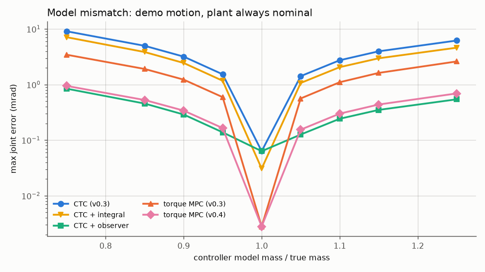
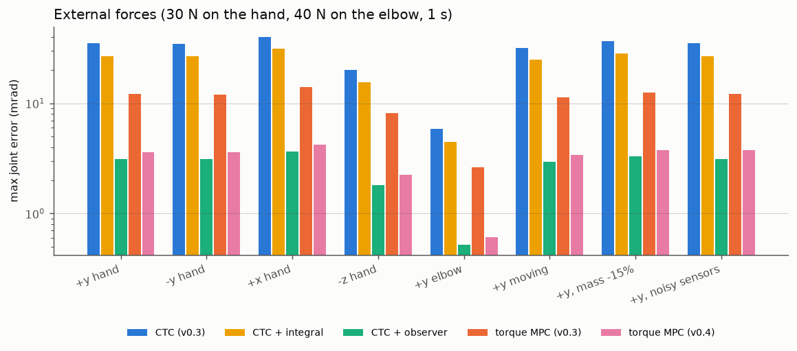
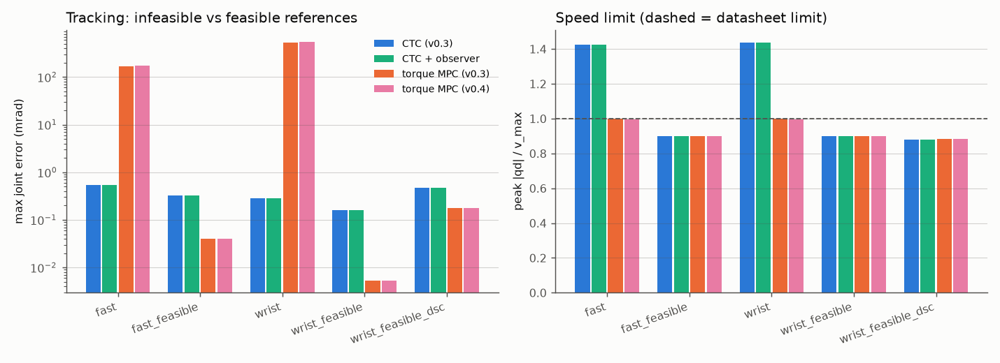

# Robotics Lab v0.4: reliability of torque MPC, trajectory feasibility and disturbance rejection

Branch `feature/mpc-v0.4-reliability`, MuJoCo 3.16, OSQP 1.1.3, Python 3.13, Windows 11.
All numbers below come from the simulated robot and the commands in
[Reproducibility](#reproducibility). The v0.3 report (`v0.3-results.md`) is unchanged.
Development log: [`v0.4-worklog.md`](v0.4-worklog.md).

## Executive summary

- **The fast/wrist "failure" of torque MPC is not a controller bug. The two
  reference trajectories are physically infeasible.** They ask joint 7 for 3.72 and 3.75
  rad/s, which is 1.43x its 2.61 rad/s limit. CTC follows them and breaks the limit by 43%.
  The torque MPC enforces the limit, so it has to fall behind: with any amount of look-ahead,
  no speed-limited controller can do better than 147 mrad (fast) or 304 mrad (wrist) max
  error. The MPC got 169 and 532 mrad. Removing only the speed limit makes it track to
  < 0.1 mrad. The same poses with feasible timing are tracked to < 0.05 mrad.
- **New trajectory generator** (`tasks/trajectory.py`). It times straight joint-space moves
  with a quintic or a jerk-limited double-S profile. Each move is lengthened automatically
  until it respects velocity, acceleration, jerk and torque limits. When a move cannot be
  made feasible, the generator says why. The original v0.3 scenarios are kept unchanged
  for historical comparison; new `*_feasible` scenarios give every controller the same
  checked reference.
- **Constraint reporting and tightening.** The benchmark now reports, separately: what the
  MPC plans predicted, what the simulated arm actually did (violation size, duration,
  integral), the solver slack, and whether the reference itself was feasible. The v0.3
  torque MPC's 369/578 violating steps were tiny overshoots (≤ 1.7e-3 rad/s, 0.07%) caused
  by prediction error while it held the speed exactly at the limit. A 0.5% velocity
  margin removes all of them. The servo MPC's violations are different: they happen
  between control updates and cannot be fixed this way.
- **Disturbance rejection.** A joint-torque disturbance observer (estimated from measured
  motion and the torque actually applied) makes the torque MPC offset-free and is also
  available for CTC. Under a 30 N push, max error falls from 12.1 to 3.6 mrad (MPC) and
  from 35.2 to 3.1 mrad (CTC), and the steady deflection disappears. With model mass errors
  of ±5–25%, error falls 3.6–4x for the MPC (e.g. 3.44 → 0.95 mrad at −25%) and about 11x
  for CTC (9.09 → 0.84 mrad), with no instability. **CTC with the observer is slightly better
  than the v0.4 torque MPC on every disturbance test.** The MPC's advantages are elsewhere:
  3–30x lower nominal tracking error on feasible references and enforced speed limits.
- **Orientation** of the hand is now measured. For joint tasks the benchmark reports
  tracking error against the joint reference's orientation. For position-only reaching it
  reports orientation change and drift, because no orientation reference exists.
- **Solver performance.** The OSQP solve plus loading new QP data into OSQP take about 77%
  of an update. 50 Hz torque MPC fits its 20 ms budget on a quiet machine (p99 10 ms, no
  misses), but under load this machine slowed 2–3x and up to 22 of 300 updates missed.
  100 Hz with an equivalent look-ahead does not fit. No solver setting tried was faster
  without losing accuracy, so none was adopted.
- **Not fixed:** the servo (position-actuator) MPC still saturates the wrist servos; it is
  worse than PID even on the new feasible wrist motion (135 vs 3.4 mrad).
- 122 automated tests pass (85 from v0.3 + 37 new).

## 1. Problems investigated

| Problem (from the v0.3 benchmark) | Finding | Status |
|---|---|---|
| Torque MPC much worse than CTC on `fast`/`wrist` | infeasible reference + MPC correctly enforcing the speed limit | explained; feasible scenarios added |
| 369 / 578 velocity-violation steps (torque MPC) | ≤ 0.07% overshoot: prediction error at an active bound | fixed by 0.5% tightening |
| CTC violates limits often | it tracks the infeasible reference (1.43x v_max) | expected; documented |
| Steady deflection under external force | no integral action / disturbance model | fixed by observer (offset-free MPC) |
| Sensitivity to model error | model gravity and inertia errors act as unknown torques | 3.6–11x smaller with the observer |
| Orientation not characterized | — | metrics, plots, tests added |
| Solver timing varies with load | 2–3x run-to-run variance in this session | quantified; 50 Hz holds, 100 Hz does not |
| Servo MPC saturation at speed | unchanged (structural, see v0.3) | not changed in v0.4 |

## 2. Root-cause investigation (fast and wrist)

Tool: `tools/diagnose_torque_mpc.py`. At every MPC update it logs the measured state,
predicted states and torques, references, solver status, iterations, solve time and slack.
It also reports the one-interval prediction error and the open-loop error of the linear
model against a nonlinear MuJoCo rollout of the same planned torques.
Raw output: `results/v0.4_diagnostics/torque_mpc_diagnostics.json`.

| Experiment (torque MPC, v0.3 settings) | max error | peak \|qd\|/v_max planned / actual | violating steps |
|---|---|---|---|
| fast, as in v0.3 | 169 mrad | 1.0000 / 1.0006 | 369 |
| wrist, as in v0.3 | 532 mrad | 1.0000 / 1.0007 | 578 |
| fast, speed limit removed | 0.10 mrad | 1.427 / 1.427 | 352 (reference itself) |
| wrist, speed limit removed | 0.04 mrad | 1.437 / 1.437 | 422 (reference itself) |
| fast poses, 1.5 s moves (0.95x v_max) | 0.02 mrad | 0.951 / 0.951 | 0 |
| wrist poses, 3.0 s moves (0.96x v_max) | 0.01 mrad | 0.958 / 0.958 | 0 |

**Lower bound.** The quintic reference's peak speed is 1.875 |Δq| / T. For each joint, the
lag a speed-limited follower must build up is L = ∫ (|q̇_ref| − v_max)⁺ dt: 294 mrad (fast)
and 608 mrad (wrist). A follower with perfect look-ahead can move ahead of the reference by
L/2 before the over-speed stretch and end up L/2 behind it after. So no controller that
respects the limit can get below ~147 / ~304 mrad max error. The MPC's 169 mrad on `fast`
is within 15% of that bound.

**Settings that do not matter** (wrist; max error unchanged to 3 digits unless noted):
solver tolerance 1e-7 (vs 1e-5), warm start off, hard instead of soft state constraints,
position weight 1e4 or 1e6 (526 / 532 mrad), velocity weight 0. Across all runs there were
no solver failures, no inaccurate solutions, no fallbacks, max slack ≤ 1e-5, and the first
planned torque was never at its limit, so actuator saturation is not involved.

**What does matter is preview length**, because a longer look-ahead lets the MPC move ahead
of the reference earlier: N = 10 (0.2 s) 594 mrad, N = 25 (0.5 s) 532, N = 40 (0.8 s) 439;
at 100 Hz, N = 25 (0.25 s) 586 and N = 50 (0.5 s) 535. Results depend on look-ahead time,
not on the control rate.

**Prediction accuracy.** The one-interval prediction is accurate: ≤ 7e-6 rad and
≤ 9.3e-4 rad/s against the next measurement. The linear model's open-loop error against a
nonlinear rollout grows roughly as k³. Mean worst-joint error is 2.5e-7 rad at k = 1, 1.4e-4
at k = 5, 1.9e-3 at k = 10, and 2.4–4.8e-2 rad at k = 25 (0.5 s), mostly on joints 4 and 6.
This does not hurt tracking, because the model is re-linearized every 20 ms and tracking is
exact with the same model error. It does mean that **late-horizon predictions, including
constraint predictions, are approximate**.

**Classification** (the categories set in the assignment):

| Category | Verdict |
|---|---|
| A. incorrect mathematical implementation | **no**: QP verified in v0.3 to 6e-14; exact tracking without the speed constraint |
| B. weights or horizon | **partly**: weights irrelevant; the 0.5 s look-ahead limits how early it can move ahead of the infeasible part |
| C. infeasible reference | **yes, primary cause** |
| D. prediction-model limits | **yes, secondary**: causes the 0.07% overshoot at the active bound; approximate late-horizon predictions |
| E. solver numerics | **no** |
| F. combination | C, with B and D as secondary contributors |

No implementation bug was found in v0.4. The only one found in this line of work was the
fallback-anchoring bug fixed in v0.3.

## 3. Trajectory generation

`tasks/trajectory.py`. A move from waypoint a to waypoint b follows the straight joint-space
line q(t) = a + (b − a) s(t). Only the timing law s(t) changes, so the path is exactly the
one the IK collision checks validated. Because s is monotonic and the joint-limit box is
convex, position feasibility reduces to checking the waypoints. Per joint,
|q̇_j| = |Δq_j| |ṡ| (and likewise for acceleration and jerk), so the joint limits become
scalar limits on s:
v_s = min_j v_max,j / |Δq_j| (likewise a_s, j_s).

* **min_jerk** (quintic, the v0.1–v0.3 profile): peaks ṡ = 1.875/T, s̈ = 5.7735/T²,
  s⃛ = 60/T³. Shortest feasible T = max(1.875/v_s, √(5.7735/a_s), ∛(60/j_s)).
* **double_s** (jerk-limited, seven constant-jerk phases): the time-optimal rest-to-rest
  profile (Biagiotti & Melchiorri 2008, §3.4), covering the cruise, acceleration-limited
  and jerk-limited cases. It cruises at the speed limit instead of touching it once, so it
  is faster at the same limits. Its jerk is piecewise constant.
* **Time scaling.** A move is never shorter than requested. If the requested duration
  breaks a limit, the move is lengthened by a uniform time stretch (velocity scales with
  1/f, acceleration with 1/f², jerk with 1/f³).
* **Torque feasibility.** Inverse dynamics of the *controller's* model is sampled at 101
  points per move. The move is stretched while any joint exceeds its torque budget
  (dynamic torque scales roughly with 1/f²; gravity does not). If gravity alone exceeds
  the budget anywhere on the path, the move is reported infeasible
  (e.g. `fast` poses with a 10% torque budget: `TrajectoryInfeasible: joint 2 needs 35.2 Nm just to hold against gravity (budget 8.7 Nm): no duration is feasible`).
* `check_reference` checks any sampled reference and reports violations in readable form:
  `joint 7 velocity 3.722 rad/s > limit 2.610 (1.43x) at t = 0.500 s`.

Configuration (`task.trajectory` in `configs/default.yaml`, `reach.yaml` and benchmark
scenarios): profile, plus fractions of the Franka datasheet limits: velocity 0.9,
acceleration 0.5, jerk 0.05 (the datasheet jerk limits of 3750–10000 rad/s³ are far above
what smooth tracking needs), torque 0.8. Without the section, tasks produce the v0.3
references bit for bit (tested).

Timing the generator chose for the v0.4 scenarios:

| scenario | requested | generated move times (s) | limiting factor |
|---|---|---|---|
| fast_feasible (min_jerk) | 1.0 s each | 1.585, 1.341, 1.000 | joint 7 velocity, joint 1 velocity, — |
| wrist_feasible (min_jerk) | 2.0 s each | 2.223, 3.193, 2.000 | joint 7 velocity, joint 7 velocity, — |
| wrist_feasible_dsc (double_s) | 2.0 s each | 2.000, 2.000, 2.000 | — (cruises at ≤ 0.9 v_max) |

## 4. Constraint handling

Constraint types and how each is enforced:

| Constraint | Torque MPC | Servo MPC | CTC | Nature |
|---|---|---|---|---|
| actuator command range (ctrlrange) | hard (QP bound + clip) | hard (QP bound + clip) | clip | exact |
| physical torque limit (forcerange) | hard, exact (u = τ) | soft on the *sustained* servo torque; spikes clipped by MuJoCo | clip | exact for torque motors |
| joint position limits | soft, 0.02 rad margin, at the knots | soft, at the knots | none | predicted (linear model) |
| joint velocity limits | soft, at the knots, tightened by 0.5% (v0.4) | soft, at the knots | none | predicted (linear model) |
| observed physics violations | measured every 2 ms by the benchmark | same | same | ground truth |

Soft constraints and a locally linear model give **no hard guarantee** about the real arm.
The tightening is sized from measured errors; it is not a robust-MPC certificate.

**Why the arm exceeded limits the plan respected.** The v0.3 torque MPC holds the
velocity constraint exactly at its bound for the whole over-speed stretch. The real arm
then exceeds it by the one-interval prediction error (≤ 1.4e-3 rad/s) plus the motion
between control updates (knots 1.0002x, between knots 1.0006x on `fast`). The velocity
margin removes this:

| torque MPC on `fast` | planned max | actual max | at knots / between knots | violating steps | longest run | ∫ excess | lag |
|---|---|---|---|---|---|---|---|
| v0.3 (margin 0) | 1.0000 | 1.0006 | 1.0002 / 1.0006 | 369 | 344 ms | 0.046 mrad | 169 mrad |
| margin 0.5% (v0.4) | 0.9950 | 0.9955 | 0.9952 / 0.9955 | 0 | 0 | 0 | 175 mrad |
| margin 1% | 0.9900 | 0.9904 | 0.9902 / 0.9904 | 0 | 0 | 0 | 181 mrad |

On `wrist`, 0.5% gives actual 0.9957x and no violations (lag 532 → 542 mrad). The margin
is about 7x the measured overshoot of 0.07%. It has no effect on feasible references, which
never reach it.

**The servo MPC is different.** Its knots stay at 0.936x v_max on `fast`, but between knots
the arm reaches 1.06x. Each setpoint step makes the stiff servo produce a velocity
transient inside the 20 ms interval. Knot tightening cannot fix this: 5% changed nothing
and 10% made it worse (1.47x). It was not adopted. On `wrist` the servo MPC's 1.44x comes
from its PID fallback (43 of 450 updates), which follows the infeasible reference at full
speed. Its QP slack after a fallback reaches 1.1 rad/s because the measured state is
already over the limit.

New benchmark columns: `mpc_max_predicted_velocity_ratio`,
`mpc_max_predicted_position_excess_rad`, `mpc_max_slack`, `max_velocity_ratio`,
`velocity_violation_max_excess` (rad/s), `velocity_limit_violation_steps`,
`velocity_violation_longest_s`, `velocity_violation_integral_rad`,
`reference_velocity_ratio`, `reference_acceleration_ratio`, `reference_torque_ratio`
(plant inverse dynamics) and `reference_feasible`.

## 5. Disturbance rejection and model uncertainty

### Approach

`controllers/disturbance.py`. The plant is modelled as M(q) q̈ + h(q, q̇) = τ_applied + d,
where d lumps external forces and model error. Every physics step (500 Hz) the observer
computes

```
d_raw[k] = ID(q[k-1], q̇[k-1], (q̇[k] − q̇[k-1]) / dt) − τ_applied[k-1]
d̂[k]     = d̂[k-1] + (dt / T)(d_raw[k] − d̂[k-1]),   clipped to ±0.5 τ_max,   T = 10 ms
```

ID is MuJoCo's inverse dynamics *of the discrete-time step* (`mjENBL_INVDISCRETE`, set on a
private copy of the controller's model). The integrator applies joint damping implicitly,
so continuous-time inverse dynamics would leave a residual of dt·damping·q̈ (~0.02 Nm)
even with a perfect model. With the exact model, d̂ stays below 1e-6 Nm (tested).

* **CTC + observer:** τ = ID(q, q̇, q̈_des) − d̂.
* **Offset-free torque MPC:** the prediction model becomes x[k+1] = A x[k] + B (τ[k] + d̂) + c,
  with d̂ treated as a known constant input over the horizon. The effort term is measured
  from τ_hold = τ_g − d̂ instead of τ_g. With feedthrough (default), the held torque is also
  corrected between updates: τ = τ_MPC − (d̂_now − d̂_at_update), a 500 Hz inner loop.
* **Anti-windup.** The observer is driven by the torque *actually applied* (after
  clipping), so it estimates the real disturbance even while the actuators saturate and
  has no error integrator to wind up. The ±0.5 τ_max clip bounds it. Tested: a 200 N push
  saturates the actuators for 138 steps, d̂ stays at its clip, and returns to 1e-10 Nm
  after release.
* **Integral action** was evaluated for CTC: q̈_des += k_i ∫e. The error dynamics are then
  e⃛ + K_d ë + K_p ė + k_i e = 0, which is stable for k_i < K_d K_p = 31250 (Routh; the
  constructor rejects larger values). k_i = 3000 was used, with conditional-integration
  anti-windup (the integral is frozen on clipped joints) and a clamp.
* **Model isolation.** In mismatch experiments the plant is always the nominal Panda.
  Controllers, the observer and the trajectory torque check use only
  `engine.controller_model` (masses and inertias scaled) and measured joint states. The
  observer never sees `xfrc_applied` or the plant's parameters (tested).

### Choosing the observer bandwidth

Exploration on the 30 N push (max error / step-to-step torque jitter with sensor noise of
1e-4 rad and 1e-3 rad/s):

| observer T | CTC push | CTC jitter | MPC push (feedthrough) | MPC jitter |
|---|---|---|---|---|
| none | 35.2 mrad | 0.21 Nm | 12.1 mrad | 0.36 Nm |
| 20 ms | 5.7 | 0.31 | 5.5 | 0.32 |
| **10 ms (chosen)** | **3.1** | **0.45** | **3.75** | **0.36** |
| 5 ms | 1.6 | 0.78 | 2.3 | 0.63 |

Without feedthrough, the MPC with a 10 ms observer reaches 7.1 mrad: the torque is held
for 20 ms between updates.

### Results (`configs/benchmark_robustness.yaml`)

All five torque controllers run on the same torque-motor Panda with the same references.
Every run stayed finite, with no MPC fallbacks and no torque saturation. Values are max
joint error in mrad.



| controller model mass / true | CTC | CTC + integral | CTC + observer | torque MPC v0.3 | torque MPC v0.4 |
|---|---|---|---|---|---|
| 0.75 | 9.09 | 7.12 | **0.84** | 3.44 | 0.95 |
| 0.85 | 4.98 | 3.85 | **0.46** | 1.91 | 0.53 |
| 0.90 | 3.18 | 2.45 | **0.29** | 1.23 | 0.34 |
| 0.95 | 1.53 | 1.17 | **0.14** | 0.59 | 0.17 |
| 1.00 (nominal) | 0.063 | 0.031 | 0.063 | **0.0028** | **0.0028** |
| 1.05 | 1.42 | 1.07 | **0.13** | 0.56 | 0.15 |
| 1.10 | 2.74 | 2.06 | **0.24** | 1.10 | 0.30 |
| 1.15 | 3.97 | 2.97 | **0.35** | 1.62 | 0.44 |
| 1.25 | 6.20 | 4.61 | **0.54** | 2.61 | 0.69 |

RMS errors show the steady-state benefit even more clearly. At mass 0.75: CTC 3.07, CTC + I
0.38, CTC + observer 0.030, MPC v0.3 1.42, MPC v0.4 0.021 mrad. The MPC v0.4 has the lowest
RMS at every mass error. Without the observer, CTC leaves 1–3 of 3 moves unsettled
(error > 2 mrad at the end of the hold) from ±10% mass error and MPC v0.3 all 3 at ±25%;
all observer variants settle.



| disturbance (1 s) | CTC | CTC + I | CTC + observer | MPC v0.3 | MPC v0.4 |
|---|---|---|---|---|---|
| 30 N +y on the hand | 35.2 | 26.8 | **3.14** | 12.1 | 3.62 |
| 30 N −y | 34.7 | 26.7 | **3.14** | 12.0 | 3.62 |
| 30 N +x | 39.9 | 31.1 | **3.65** | 14.1 | 4.23 |
| 30 N −z (≈ 3 kg load) | 20.0 | 15.4 | **1.81** | 8.14 | 2.24 |
| 40 N +y on the elbow (link 4) | 5.83 | 4.44 | **0.52** | 2.62 | 0.61 |
| 30 N +y during the first demo move | 31.8 | 25.0 | **2.96** | 11.3 | 3.42 |
| 30 N +y with masses −15% | 36.5 | 28.1 | **3.29** | 12.4 | 3.74 |
| 30 N +y with sensor noise | 35.3 | 26.8 | **3.14** | 12.1 | 3.75 |

Steady deflection at the end of the push: CTC 35 mrad, MPC v0.3 11.7 mrad; every
observer variant ≤ 0.005 mrad. Orientation under the +y push: CTC 2.18°, MPC v0.3 0.95°,
CTC + observer 0.19°, MPC v0.4 0.24°. Settling after release: CTC + I is slowest
(0.51 s vs 0.19 s for CTC). Integral action trades transient for steady-state error and
is not competitive with the observer here.

**Conclusion.** The observer is the approach the data supports. It fixes model error and
external forces alike, does not wind up, and leaves nominal tracking untouched. It is on
by default for the torque MPC (`torque_mpc.disturbance_observer.enabled`) and optional for
CTC; both v0.3 controllers remain in the benchmarks. CTC + observer acts on d̂ every 2 ms
with no QP in the loop, which is why it rejects disturbances slightly better than the
offset-free MPC.

**Sensor noise** (`noise_demo`): the torque MPC is more noise-sensitive than CTC
(0.29 vs 0.09 mrad max). With Q = 1e5, the MPC's large position weight passes position
noise straight into the torque.

## 6. End-effector orientation

* `simulation/kinematics.rotation_angle(R_a, R_b)` gives the geodesic angle of
  R_aᵀR_b, computed as 2·atan2(|v|, |w|) from its quaternion. This stays accurate near 0
  and near π, where arccos((tr − 1)/2) loses precision. Tests cover angles from 0 to π,
  symmetry, and a joint-7 rotation of exactly 0.25 rad.
* `ArmKinematics.fk_pose(q)` returns the site position and rotation matrix.
* Benchmark metrics (FK of logged joints, every 5th step):
  * `ee_orientation_max_error_deg` / `ee_orientation_rms_error_deg`: **tracking error**
    against the orientation implied by q_ref. Defined only for joint-space tasks, where
    the reference fixes the full pose.
  * `ee_orientation_change_max_deg`: **orientation change** from the start, for every task.
  * `ee_orientation_hold_drift_max_deg`: drift while holding still at a waypoint.
  * Reach tasks report NaN for tracking error. They are position-only (IK leaves the
    orientation free), so there is no orientation reference to track. The reach scenario
    turns the hand by up to 49° while reaching its targets, with < 0.001° drift during
    holds.
* Plot: `orientation.png` in each benchmark output directory.

## 7. Solver performance

`tools/profile_mpc.py` (demo motion, 6 s per variant). **Wall-clock time on this machine
varied 2–3x between and even within runs.** The calibration (mean `mj_step` time measured
before each variant) ranged from 26 to 85 µs. The table therefore gives the quietest of
four runs, with the range over all runs in the last column. Iteration counts are
deterministic.

| variant | rate | N | mean | p95 | p99 | misses (quiet run) | linearize | OSQP update | OSQP solve | rest | mean, all runs |
|---|---|---|---|---|---|---|---|---|---|---|---|
| torque MPC (v0.4) | 50 Hz | 25 | 4.96 | 7.36 | 10.06 | 0 / 300 | 0.57 | 1.08 | 2.80 | 0.48 | 4.96–14.1 ms (misses 0–22) |
| torque MPC | 100 Hz | 25 | 9.56 | 14.19 | 19.47 | 215 / 600 | 1.01 | 1.90 | 5.47 | 1.10 | 9.6–14.9 ms (misses 215–541) |
| torque MPC | 100 Hz | 50 | 18.76 | 26.33 | 49.15 | 600 / 600 | 1.16 | 3.89 | 11.66 | 1.94 | 18.8–23.6 ms (all miss) |
| servo MPC | 50 Hz | 15 | 3.35 | 3.81 | 4.67 | 0 / 300 | 0.55 | 0.75 | 1.56 | 0.44 | 3.35–3.84 ms (no misses) |
| servo MPC | 100 Hz | 15 | 6.35 | 9.21 | 12.59 | 18 / 600 | 0.89 | 1.34 | 3.09 | 0.94 | 6.35–8.66 ms (misses 18–158) |

(ms per update; the torque-MPC 100 Hz rows of the quiet run were measured on the
`wrist_feasible` motion.)

* **Proportions are stable across runs** even though absolute times are not. For the
  torque MPC: OSQP solve 56–57%, OSQP update 18–22%, linearization 11–12%, gravity
  torque 1%, the rest (numpy QP data, preview, bookkeeping) 10–11%. Mean iterations: 45
  on demo, 34 on wrist_feasible.
* **Hotspots** (cProfile): OSQP solve 44% and OSQP update 33%. The A matrix values
  (linearized dynamics) change every update, so OSQP refactors its KKT matrix each time.
  Then come `mjd_transitionFD` and the rollout for c, and the reference preview
  (25 Python calls per update, ~0.5 ms).
* **Observer.** 21 µs per physics step (mj_inverse 10 µs + state copy 5 µs), about the
  cost of one `mj_step`.
* **Memory.** tracemalloc shows no growth besides OSQP's one-time 1.2 MB workspace and the
  per-update statistics records.
* **Tried and rejected** (all measured):

  | change | effect | verdict |
  |---|---|---|
  | eps 1e-4 | more iterations (46 vs 34) | rejected |
  | polishing off | solve 25–30% faster; demo error 2.8 → 29.6 µrad, push 3.62 → 3.96 mrad | rejected (as in v0.3) |
  | eps 1e-4 + polishing off | wrist_feasible error 0.005 → 2.6 mrad | rejected |

* **Conclusion.** 50 Hz with a 0.5 s horizon fits the 20 ms budget on a quiet machine,
  with misses under load (up to 22 of 300 updates). 100 Hz with an equivalent 0.5 s
  horizon does not fit in this Python/OSQP implementation. The remaining speed-ups are
  structural (see §10).

## 8. Before and after: main benchmark

`configs/benchmark.yaml`. The first seven scenarios are the v0.3 scenarios, unchanged;
the `*_feasible*` scenarios are new and give every controller the same checked reference.
`pid`/`mpc`/`mpc_100hz` use position servos and the `torque_*` controllers use torque
motors, so compare within each group. `torque_mpc_v03` and `torque_ctc` are the v0.3
controllers.



**Regression.** The v0.3 controllers (`pid`, `mpc`, `mpc_100hz`, `torque_ctc`,
`torque_mpc_v03`) on the v0.3 scenarios reproduce the re-run v0.3 baseline. PID and CTC
match exactly. The MPC metrics differ by at most 1.6e-9 rad, which is floating-point
round-off: the reworked task code produces references that differ from v0.3 by ≤ 2.2e-16
(one rounding step), and the MPC's iterative QP solver amplifies that slightly. Every
count is identical: velocity and joint-limit violations, fallbacks and contacts.

**Max joint error (mrad)**, torque-motor controllers:

| scenario | reference | CTC (v0.3) | CTC + observer | torque MPC v0.3 | torque MPC v0.4 |
|---|---|---|---|---|---|
| demo | feasible | 0.063 | 0.063 | **0.0028** | **0.0028** |
| near_limits | feasible | 0.093 | 0.093 | **0.0037** | **0.0037** |
| reach | feasible | 0.031 | 0.031 | **0.0022** | **0.0022** |
| demo_mismatch (masses −15%) | feasible | 4.98 | **0.46** | 1.91 | 0.53 |
| push (30 N, 1 s) | feasible | 35.2 | **3.14** | 12.1 | 3.62 |
| fast | **1.43x v_max** | 0.54 | 0.54 | 169 | 175 |
| wrist | **1.44x v_max** | 0.29 | 0.29 | 532 | 541 |
| fast_feasible | feasible | 0.32 | 0.32 | **0.040** | **0.040** |
| wrist_feasible | feasible | 0.16 | 0.16 | **0.0053** | **0.0053** |
| wrist_feasible_dsc | feasible | 0.48 | 0.48 | **0.17** | **0.17** |

On feasible references with the exact model, the torque MPC's max error is 3–30x below
CTC's: 2.7x for the double-S profile, whose piecewise-constant jerk the MPC cannot
anticipate within a 20 ms hold, and up to 30x for wrist_feasible. With model error or
pushes, CTC + observer is best and the v0.4 MPC is close behind (10–30% higher error). These
are nominal simulation results with no sensor noise; with noise, the MPC's advantage at
rest shrinks (§5).

**Constraints**, torque motors (peak |q̇|/v_max actual; planned in brackets; violating
physics steps):

| scenario | CTC | torque MPC v0.3 | torque MPC v0.4 |
|---|---|---|---|
| fast | 1.4252, 352 steps | 1.0006 (1.0000), 369 steps, max excess 1.4e-3 rad/s | **0.9955 (0.9950), 0** |
| wrist | 1.4365, 420 steps | 1.0007 (1.0000), 578 steps, max excess 1.7e-3 rad/s | **0.9957 (0.9950), 0** |
| all feasible scenarios | ≤ 0.9655, 0 | ≤ 0.9655, 0 | ≤ 0.9655, 0 |

No joint-limit violations, contacts, non-finite states, torque saturation or MPC
fallbacks occurred in any torque-motor run. Max MPC slack is ≤ 8e-6 everywhere.

**Position servos** (unchanged controllers; max error mrad / peak speed ratio / violating
steps):

| scenario | PID | servo MPC 50 Hz | servo MPC 100 Hz |
|---|---|---|---|
| demo | **3.42** / 0.48 / 0 | 7.83 / 0.51 / 0 | 6.43 / 0.56 / 0 |
| fast (infeasible) | **2.98** / 1.43 / 354 | 300 / 1.06 / 194 | 355 / 1.03 / 166 |
| wrist (infeasible) | **3.44** / 1.44 / 430 | 47.8 / 1.44 / 467 (43 fallbacks) | 13.7 / 1.44 / 455 (90 fallbacks) |
| fast_feasible | **3.30** / 0.90 / 0 | 31.1 / 0.97 / 0 | 11.2 / 0.93 / 0 |
| wrist_feasible | **3.44** / 0.90 / 0 | 135 / 1.06 / 92 | 13.4 / 0.98 / 0 |
| wrist_feasible_dsc | **3.44** / 0.89 / 0 | 13.4 / 0.96 / 0 | 14.6 / 0.98 / 0 |

Feasible timing does not rescue the servo MPC on the wrist moves. At 50 Hz it reaches
135 mrad with 28% of steps torque-saturated and intersample speed overshoot to 1.06x,
while PID stays at 3.4 mrad. This is the v0.2/v0.3 servo-saturation problem (setpoint
steps drive the 12 Nm wrist servos into their force clip), not a reference problem. It is
recorded here but was not investigated further in v0.4.

**End-effector orientation** (max tracking error, degrees): demo: PID 0.42, servo MPC
0.35, CTC 0.004, torque MPC 0.0002. fast (infeasible): torque MPC 10.0 (it lags the
infeasible reference), CTC 0.036. push: CTC 2.18, CTC + observer 0.19, MPC v0.3 0.95,
MPC v0.4 0.24. Plots: `figures/v0.4-orientation.png`, `figures/v0.4-velocity-ratio.png`,
`figures/v0.4-tracking-error.png`. Every metric is in `v0.4-benchmark-results.csv`.

## 9. Failed experiments and limitations

* **Rejected:** velocity tightening for the servo MPC (no effect at 5%, worse at 10%);
  OSQP polishing off; eps 1e-4; a 5 ms observer (too noise-sensitive); integral action
  for CTC as the main disturbance remedy (it reduces steady-state error but not peaks,
  and settles more slowly).
* **Still linear MPC.** One linearization per update, held across the horizon. Open-loop
  prediction error reaches ~2–5e-2 rad at the end of the 0.5 s horizon. Constraint
  predictions late in the horizon are therefore approximate, and the soft constraints
  provide no guarantee.
* **Observer assumptions.** The observer needs an accurate velocity measurement and
  differentiates it. Tested only with white Gaussian noise of 1e-3 rad/s; real encoder
  quantization, delay and filtering are not modelled. It estimates a lumped joint torque:
  it cannot separate model error from contact forces, and it treats d as constant over
  the 0.5 s horizon.
* **Torque MPC remains more noise-sensitive than CTC** (Q = 1e5 on position).
* **Over-speed references** are still followed with a large lag by any speed-limited
  controller. Over-speed references should be time-scaled by the trajectory generator,
  which is now the default for `main.py` tasks. Historical benchmark scenarios
  deliberately keep the old timing.
* **Mismatch model.** Masses and inertias are scaled uniformly; friction, damping,
  armature and centre-of-mass errors were not varied.
* **The servo MPC is unchanged** apart from new reporting. Its intersample velocity
  overshoot, fallbacks (43 of 450 wrist updates) and wrist-servo saturation remain. On
  the feasible wrist motion it reaches 135 mrad, against 3.4 mrad for PID.
* **Timing** is wall-clock on a desktop OS with 2–3x run-to-run variance. No real-time
  guarantees.

## 10. Recommendations for v0.5

1. **Real-time margin at 100 Hz.** Stop refactoring the KKT matrix every update: keep A/B
   fixed for several updates and correct with the affine term, or use a structure-
   exploiting solver (Riccati / HPIPM-style) or a condensed formulation with a dense
   solver. Measure the accuracy cost against the current 50 Hz controller.
2. **LTV prediction or SQP-RTI.** Re-linearize along the shifted previous plan to cut the
   k³ open-loop error growth. This matters for constraint predictions and for any claim
   about predicted feasibility.
3. **Noise-aware estimation.** Replace finite-differenced velocity in the observer with a
   Kalman filter or momentum observer on q, and add encoder quantization and delay to the
   sensor model. Re-tune the MPC position weight under noise.
4. **Richer mismatch tests:** friction, damping, centre of mass, payload in the gripper.
5. **Pick-and-place:** grasp, carry a payload (where the observer should help), and place,
   using double-S timing and the existing IK and collision checks.

## Reproducibility

```powershell
.\.venv\Scripts\python.exe -m pytest tests -v                                    # 122 tests
.\.venv\Scripts\python.exe benchmark.py --output results\v0.4_final              # main benchmark (~15 min)
.\.venv\Scripts\python.exe benchmark.py --config configs\benchmark_robustness.yaml --output results\v0.4_robustness
.\.venv\Scripts\python.exe tools\diagnose_torque_mpc.py                          # section 2 experiments
.\.venv\Scripts\python.exe tools\profile_mpc.py                                  # section 7 timing
.\.venv\Scripts\python.exe tools\plot_v04.py                                     # figures in docs/research/figures
```

The v0.3 baseline was re-run unchanged into `results/v0.4_baseline_v0.3/`. Every tracking
and constraint metric matched `results/v0.3_final` exactly. All simulations are
deterministic (fixed initial state; sensor noise has a fixed seed). Only wall-clock timing
varies. `results/` is git-ignored. `docs/research/v0.4-benchmark-results.csv` and
`v0.4-robustness-results.csv` are copies of the final result tables.
