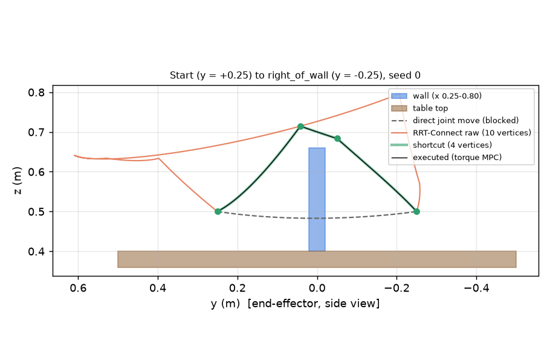
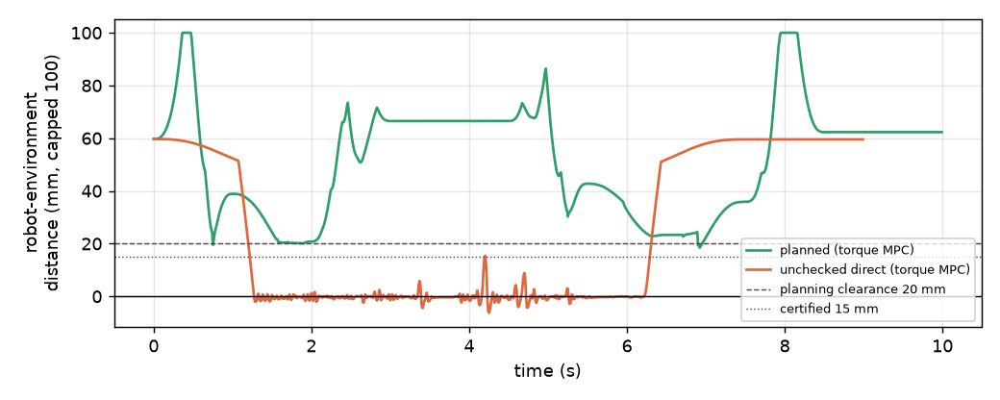
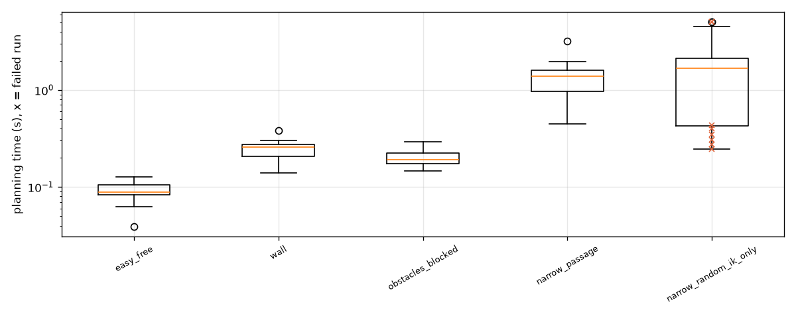
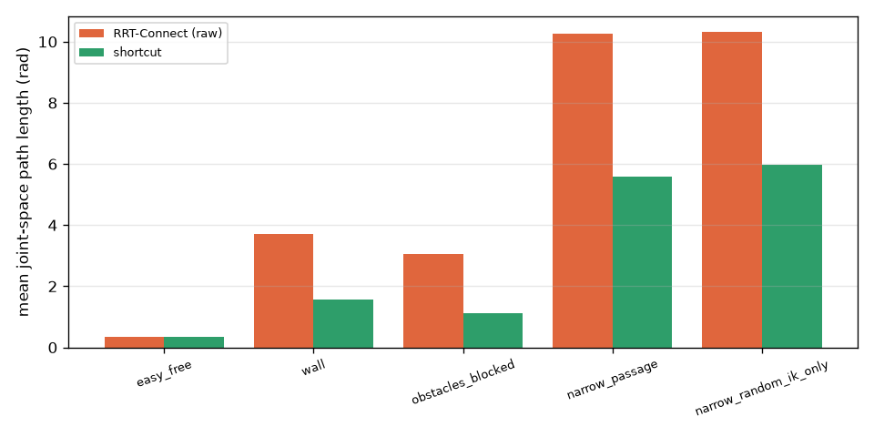

# Robotics Lab v0.5: collision-aware motion planning

Branch `feature/v0.5-motion-planning` (from v0.4 `b807baa`). Development log:
[`v0.5-worklog.md`](v0.5-worklog.md). Raw data: [`v0.5-planning-runs.csv`](v0.5-planning-runs.csv)
(220 planning runs), [`v0.5-planning-summary.csv`](v0.5-planning-summary.csv),
[`v0.5-execution-runs.csv`](v0.5-execution-runs.csv) (30 closed-loop runs).

## Executive summary

- A joint-space **RRT-Connect** planner (`planning/`) finds collision-free routes for the
  Panda's 7 joints when the straight joint move is blocked. Planning runs once, when the task
  is built. The existing controllers receive an ordinary joint reference through the
  unchanged controller interface.
- **Collision validation** reuses MuJoCo's own collision detection on a private model copy. A
  20 mm clearance is implemented with contact margins, and edges are sampled so that no robot
  point moves more than 10 mm between samples. That certifies at least 15 mm from the
  environment everywhere on a checked edge. Self-collision is checked only at the samples.
- **Demonstration** (`configs/planning_demo.yaml`): the arm reaches from one side of a wall to
  the other. The straight joint move would sweep the hand through the wall. The planner finds
  a route over it in ~0.25 s, and torque MPC follows it in MuJoCo with **0 contact steps** and
  a final end-effector error of 0.01-0.06 mm.
- **Benchmark**: 11 scenarios × 20 seeds, every run reported.
  - Blocked scenarios: 20/20 on the wall, obstacle-block and narrow-passage scenes.
  - Failure scenarios: each fails 20/20 with its own status (unreachable, invalid start, no
    valid IK, timeout). The node-budget scenario fails 19/20 with `node_budget`; seed 3 fits
    its path inside the 8-node budget.
  - Execution: all 24 planned executions (4 scenes × torque MPC/CTC × 3 seeds) succeed with
    0 contacts and at least 16.2 mm measured clearance.
  - Baseline: all 8 executions of the unchecked direct move collide (1005-1581 contact steps)
    and stall 175-470 mm from the goal.
- Three defects were found and fixed by tests and measurements rather than by tuning:
  - **MuJoCo midphase.** It misses ~20% of near misses inside a contact margin.
  - **Path shortcutting.** Two bugs made "optimized" paths longer.
  - **IK posture selection.** It, not RRT, caused 8/20 failures in the narrow passage.

## 1. Architecture

```
config task.planning ──► SimulationRunner._build_task (once)
                           │  MotionPlanner (planning/motion_planner.py)
                           │    ik_candidates ─► RRTConnect ─► shortcut ─► path_valid
                           │    CollisionChecker (private MjModel copy, scratch MjData)
                           ▼
       CartesianReachTask / PlannedJointTask: path vertices -> via points
                           ▼
       JointTargetTask (v0.4 timing: per-edge rest-to-rest, feasibility-scaled)
                           ▼
 task.reference(t) -> controller.compute(...) -> engine.set_arm_command -> mj_step   (500 Hz, unchanged)
```

| module | role |
|---|---|
| `planning/collision.py` | `CollisionChecker`: configuration, edge and path validity, clearance, lever-arm motion bound |
| `planning/rrt_connect.py` | `RRTConnect`, `RRTSettings`, `PlanStatus` |
| `planning/shortcut.py` | greedy pruning + seeded random shortcuts, re-validation, fallback to the raw path |
| `planning/ik.py` | `ik_candidates`: several converged *and* valid IK postures |
| `planning/motion_planner.py` | `MotionPlanner.plan_joint` / `plan_to_position` -> `MotionPlan` |
| `planning/visualization.py` | planned end-effector paths drawn in the viewer's `user_scn` (visual only) |
| `tasks/planned_joint.py` | joint-waypoint task whose moves follow planned paths; `PlanningFailed` |
| `simulation/planning_benchmark.py`, `planning_benchmark.py` | benchmark driver |

The planner never writes the live `MjData`. It reads only the finger positions, once, when it
is built. It never disables collisions, edits geometry or teleports the robot. If planning
fails, the direct move is not used as a substitute: a Cartesian target is rejected with the
reason, and a joint-waypoint task raises `PlanningFailed`.

## 2. Collision validation

**Configuration check.** A configuration is valid if it lies inside the joint limits shrunk by
0.05 rad and MuJoCo reports no robot contact. The check runs `mj_kinematics + mj_collision` on
scratch data of a model copy. All of MuJoCo's intended filtering applies unchanged:
contype/conaffinity, parent-child filtering, Menagerie's link0-link1 exclude and the engine's
base-table exclude.

**Clearance.** On the copy, every collidable environment geom gets `geom_margin = 0.02 m`. A
pair's margin is the larger of the two, so robot-environment pairs report contacts below 20 mm
and `contact.dist` is the true signed distance (matches `mj_geomDistance` to 1e-5 m).
Robot-robot pairs keep margin 0, so self-collision means penetration. The plant model is not
modified.

**Edge sampling.** For joint j, R_j bounds the distance from its anchor to any robot collision
geom that it moves. The bound is the chain of body offsets plus the geom offset plus its
bounding radius, and it holds for every posture. Values:
[1.149, 1.149, 0.833, 0.751, 0.358, 0.358, 0.270] m. Along a straight joint edge, every point
of the robot travels at most Σ R_j |Δq_j|. Edges are split so this is ≤ 10 mm per sample
interval, and no joint moves more than 0.05 rad. `test_edge_sampling_bound_is_conservative`
confirms the bound on random edges.

**What this certifies.** Assume every sample has distance ≥ c = 20 mm. Distance is 1-Lipschitz
in each point's position, and every point lies within half a step of a sampled position. So
every configuration on the edge has robot-environment distance ≥ c - step/2 = **15 mm**. This
holds for MuJoCo's collision geometry (convex hulls of the meshes), not for the real robot.
Self-collision has margin 0 and is checked only at the samples, so a short self-intersection
between samples could be missed. This is **discrete** collision checking with a clearance
argument. It is not continuous collision detection.

**MuJoCo midphase finding.** A test that sampled the executed demo reference found a
configuration 8.8 mm from the wall, below the promised 15 mm. The cause: MuJoCo's midphase
(per-body BVH culling, used for multi-geom bodies such as the fingers) ignores the other geom's
margin. It dropped a finger-wall pair 8.5 mm apart under a 20 mm margin. Ground truth over 3000
random configurations per scene (exhaustive `mj_geomDistance` over all collidable pairs):

| | planning_demo | obstacles |
|---|---|---|
| midphase on: near misses missed | 14 of 91 | 16 of 74 |
| midphase off: false negatives / false positives | 0 / 0 | 0 / 0 |
| cost per configuration check (midphase off) | 26 µs | 24 µs |

The checker's model copy disables the midphase, and
`test_checker_matches_exhaustive_distance_ground_truth` guards it. The plant, with margin 0,
only needs penetrations, which the midphase handles.

## 3. RRT-Connect

The planner follows Kuffner & LaValle (2000). Two trees grow, from the start and from the
goal. Each iteration samples a configuration uniformly inside the margin-shrunk joint box,
EXTENDs tree A one step towards it, then CONNECTs tree B to the new node (repeated steps until
it reaches the node or is blocked). The trees then swap roles.

- **Metric.** Weighted Euclidean, w_j = R_j / R_1 floored at 0.2:
  [1, 1, 0.725, 0.653, 0.311, 0.311, 0.235]. A radian at the shoulder sweeps the arm much
  further than a radian of wrist roll. The step size is 0.3 in this metric.
- **Tree edges.** Every new node is checked as a configuration and its edge to the parent is
  checked as an edge, so the reconstructed path is valid edge by edge. Edge checks run
  coarse-to-fine (midpoint first) for early rejection. Nearest neighbours are a vectorized
  scan over preallocated arrays.
- **Direct edge.** It is checked first. If it is valid, the path is [start, goal]. Its validity
  is recorded either way.
- **Budgets and statuses.** Time (`timeout`), total nodes (`node_budget`) and iterations
  (`no_path`, "no valid path found"). Invalid endpoints give `invalid_start` / `invalid_goal`
  with the offending contact or joint.
- **Determinism.** A fixed seed gives an identical path, node count and check count, unless
  the time budget ends the run (`test_rrt_is_deterministic_for_a_seed`).
- **Time budget.** For Cartesian goals, `rrt.max_time` covers IK, every RRT attempt and the
  shortcutting.

## 4. Multiple IK postures

A position target leaves a 4-D family of joint solutions. `ik_candidates` runs damped
least-squares IK from these seeds:

- the current configuration;
- the rest posture;
- 8 Gaussian perturbations of the current configuration (σ 0.5 rad);
- 12 uniform random configurations.

For perturbed and random seeds, the null-space term pulls towards the seed itself, so they
converge to distinct postures. A posture qualifies only if IK converged (error < 0.1 mm) *and*
the checker accepts it. A small IK error alone never qualifies a colliding posture.

Candidates are sorted by weighted distance from the start, and up to 4 are attempted. Each gets
a fair share of the remaining time, and unused time carries over. Failure reasons:

- `unreachable`: no seed converges ("Cartesian target unreachable");
- `no_valid_ik`: solutions converge, but all collide or violate the clearance;
- otherwise, the last RRT status.

**Narrow-passage diagnosis** (`planning_narrow`, wall under a ceiling): with random IK seeds
only, 8 of 20 seeds failed.

- In the timeouts, *every* valid posture found had the shoulder leaned back (q2 from -0.8 to
  -1.7). Each one timed out alone even with 20 s and ~2400 nodes.
- So the failures came from posture selection, not from RRT.
- Seeds near the current posture fixed it:

| IK seeds (narrow passage, 20 seeds) | success | failures | wall scene median time |
|---|---|---|---|
| 12 random (first draft) | 12/20 | 6 no_valid_ik, 2 timeout | 0.21 s |
| 40 random | 17/20 | 3 timeout | 1.19 s |
| 12 random + 8 local (adopted) | **20/20** | - | 0.57 s |

`multi_ik_near_obstacle` shows why posture choice matters even without a narrow passage:

- The v0.4 IK-only planner accepts a posture 17 mm from `obstacle_1`, because it only checks
  for penetration.
- The planner rejects that posture on clearance and reaches the target with another one
  (20/20; `test_multi_ik_scenario_needs_a_posture_other_than_the_v04_ik_solution`).

## 5. Shortcutting

The shortcutter works in two passes, then re-validates:

- **Greedy pruning.** From each kept vertex, jump to the farthest vertex that a valid straight
  edge reaches.
- **Random shortcuts.** 100 seeded iterations between points drawn uniformly by path length;
  the points may lie inside edges.
- **Re-validation.** Pruning runs again, then the whole path is re-checked vertex by vertex and
  edge by edge. If that fails, the raw RRT path is returned unchanged. There is no spline
  smoothing: the output is a polyline whose edges are exactly what the trajectory executes.

Measuring iterations exposed two bugs, both fixed (12 wall paths, raw mean 3.65 rad):

1. **Metric mismatch.** Shortcuts were accepted by the weighted metric while the unweighted
   length was reported. Trading shoulder motion for wrist motion lowered one and raised the
   other. The shortcutter now minimizes the reported unweighted length.
2. **Fallback to the raw path.** Long runs fell back to the raw path. A new vertex on a
   validated edge is only certified to 15 mm, but re-validation requires 20 mm at new sample
   positions, and the same holds for the shortened old edges. Shortcuts now check new vertices
   and both partial edges, as the final check does.

| iterations | 0 (prune only) | 50 | 100 (default) | 400 | 800 |
|---|---|---|---|---|---|
| before fixes: length (rad) | 1.97 | 1.49 | 1.71 | 1.92 | 2.37 |
| after: length (rad) / vertices | 1.97 / 3.4 | 1.47 / 4.6 | 1.45 / 4.7 | 1.40 / 5.8 | 1.40 / 5.8 |

Shorter paths have more vertices, and each vertex is a stop. 100 iterations is the compromise.

## 6. Trajectory execution

Each path vertex becomes a waypoint. Every edge is a v0.4 rest-to-rest segment along the
straight, checked joint line, so the reference stays exactly on validated edges.

- **Timing.** Each edge takes at least `segment_time` (1.0 s) and is lengthened by the v0.4
  generator to respect 90% of the speed limits, 50% of the acceleration limits, a jerk limit
  and an 80% torque budget.
- **Holds.** The arm stops at via points without holding, and holds only at targets.
- **Unchanged v0.4 behaviour.** A planned move that is just the free direct edge keeps
  `move_time`. So enabling planning leaves free tasks bit-identical to v0.4
  (`test_planning_on_free_joint_moves_matches_unplanned_task`).
- **Demo reference check.** `test_planned_reference_is_continuous_feasible_and_collision_free`
  verifies that it is continuous, within the speed/acceleration/jerk limits, passes through
  every vertex, and keeps at least 15 mm from the environment at every sample.

## 7. The demonstration

Scene `environments/planning_demo.xml`: the table plus a wall at x 0.25-0.80 m, y ±0.02 m,
z 0.40-0.66 m.

**How the scenario was chosen.** I searched four symmetric start/goal pairs across the wall,
5 seeds each. All 20 had a blocked direct edge and all 20 plans succeeded. I chose the
end-effector positions (0.45, ±0.25, 0.50). The start joint configuration comes from IK
(rounded and re-verified) and is saved in the config. The targets are `right_of_wall`, then
`back_left`.





| run (torque MPC) | outcome |
|---|---|
| planning enabled | both direct edges blocked; plans 0.23 / 0.28 s, 21 / 22 nodes, 4.39 → 1.41 rad (4 vertices) and 4.74 → 1.19 rad (5 vertices); final EE error 0.02 / 0.05 mm; 0 contact steps; 0 MPC fallbacks |
| `--controller ctc` | same plans (planning does not depend on the controller); final EE error 0.01 / 0.05 mm; 0 contact steps |
| `--plan-seed 3` | different routes (1.92 → 1.32 and 3.47 → 1.48 rad); 0 contact steps; 0.01 / 0.01 mm |
| `--no-planning` | `right_of_wall` rejected ("collision on path: wall-link6"); the arm stays clear of the wall |
| `--no-planning --unchecked-direct` | 1849 contact steps (hand, link6, link7 against the wall); stuck 307 mm from the goal |

**Side finding.** With the path check skipped, the v0.4 torque-feasibility check still rejected
the move ("joint 1 needs 140903 Nm"). `mj_inverse` includes contact forces where the reference
penetrates the wall. This is accidental and samples only 101 points. It is not relied on, and
`--unchecked-direct` disables it explicitly.

## 8. Benchmark (`configs/benchmark_planning.yaml`)

### Planning: 20 seeds per scenario, all runs reported

Times include IK, all RRT attempts and shortcutting. "Min clearance" is the smallest true
distance along every successful path, sampled 4× finer than the planner samples.
"v0.4 IK-only" is what the previous straight-path check does with the same query.

| scenario | success | statuses | direct blocked | time mean / median / p95 (s) | nodes | checks | raw → smoothed (rad) | vertices | min clearance (mm) | v0.4 IK-only |
|---|---|---|---|---|---|---|---|---|---|---|
| easy_free | 20/20 | success 20 | 0/20 | 0.091 / 0.089 / 0.119 | 2 | 65 | 0.33 → 0.33 | 2.0 | ≥100 | accepted |
| wall | 20/20 | success 20 | 20/20 | 0.248 / 0.257 / 0.308 | 17 | 4509 | 3.72 → 1.57 | 4.5 | 15.7 | rejected (wall-link6) |
| obstacles_blocked | 20/20 | success 20 | 20/20 | 0.201 / 0.190 / 0.259 | 11 | 3185 | 3.06 → 1.12 | 5.8 | 17.5 | rejected (obstacles-hand) |
| narrow_passage | 20/20 | success 20 | 20/20 | 1.338 / 1.378 / 2.014 | 99 | 14211 | 10.27 → 5.59 | 6.5 | 19.8 | rejected (wall-hand) |
| narrow_random_ik_only | 12/20 | success 12, no_valid_ik 6, timeout 2 | 14/20 | 1.843 / 1.670 / 5.002 | 122 | 14088 | 10.31 → 5.98 | 6.6 | 20.0 | rejected (wall-hand) |
| multi_ik_near_obstacle | 20/20 | success 20 | 20/20 | 0.787 / 0.748 / 1.073 | 8 | 6272 | 2.24 → 1.59 | 3.6 | 18.7 | accepted (17 mm from obstacle) |
| unreachable | 0/20 | unreachable 20 | - | 1.005 / 0.998 / 1.187 | 0 | 1 | - | - | - | rejected (IK, 361 mm) |
| start_in_collision | 0/20 | invalid_start 20 | - | 0.001 / 0.001 / 0.001 | 0 | 1 | - | - | - | rejected |
| goal_in_collision | 0/20 | no_valid_ik 20 | - | 0.225 / 0.223 / 0.328 | 0 | 18 | - | - | - | rejected |
| timeout (5 ms) | 0/20 | timeout 20 | 20/20 | 0.008 / 0.007 / 0.011 | 3 | 87 | - | - | - | n/a (joint goal) |
| node_budget (8 nodes) | 1/20 | node_budget 19, success 1 | 20/20 | 0.041 / 0.035 / 0.051 | 8 | 550 | 1.90 → 1.31 | 4.0 | 20.4 | n/a (joint goal) |

Shortcutting removes 58% (wall), 63% (obstacles_blocked) and 46% (narrow_passage) of the raw
joint-space length on average. Every successful path passed re-validation by an independently
built checker. The narrow passage costs ~5× the time and ~6× the nodes of the open wall. In
`node_budget`, seed 3 happened to fit its path inside 8 nodes; it is reported as a success.

 

### Execution in MuJoCo: 4 scenarios × 2 controllers × 3 seeds, plus unchecked baselines

The planning seed changes the route, so each seed is a different path. "Reached" is the time
after which the end effector stays within 1 mm of the target. Contact steps are physics steps
with any robot contact in the plant. Clearance is the smallest robot-environment distance at
the executed joints (every 5th step, capped at 100 mm).

| scenario | controller | planned runs ok | final EE (mm) | max joint err (rad) | contact steps | min clearance (mm) | q / v violations | fallbacks |
|---|---|---|---|---|---|---|---|---|
| easy_free | torque MPC | 3/3 | 0.005 | 7.4e-7 | 0 | ≥100 | 0 / 0 | 0 |
| easy_free | CTC | 3/3 | 0.005 | 1.2e-5 | 0 | ≥100 | 0 / 0 | 0 |
| wall | torque MPC | 3/3 | 0.012-0.064 | 3.1e-5 | 0 | 16.2 | 0 / 0 | 0 |
| wall | CTC | 3/3 | 0.012-0.064 | 1.5e-4 | 0 | 16.3 | 0 / 0 | 0 |
| obstacles_blocked | torque MPC | 3/3 | 0.005-0.063 | 1.2e-5 | 0 | 18.4 | 0 / 0 | 0 |
| obstacles_blocked | CTC | 3/3 | 0.005-0.063 | 1.0e-4 | 0 | 18.4 | 0 / 0 | 0 |
| narrow_passage | torque MPC | 3/3 | 0.008-0.100 | 5.1e-5 | 0 | 20.2 | 0 / 0 | 0 |
| narrow_passage | CTC | 3/3 | 0.008-0.100 | 3.7e-4 | 0 | 20.2 | 0 / 0 | 0 |

Planned versus reached times, per seed (identical for both controllers to within 0.01 s):

| scenario | planned motion / reached (s) |
|---|---|
| wall | 3.00 / 2.93, 5.00 / 4.88, 3.00 / 2.93 |
| obstacles_blocked | 6.00 / 5.87, 6.00 / 5.90, 5.00 / 4.89 |
| narrow_passage | 7.69 / 7.54, 4.00 / 3.93, 6.67 / 6.57 |
| easy_free | 3.00 / 2.76 |

The executed motion matches the plan because the via-point stops make every edge rest-to-rest.

**Unchecked direct baseline** (planning off, no path check, no torque check; seed 0, once per
controller):

| scenario | controller | contact steps | final EE (mm) | min distance (mm) | other |
|---|---|---|---|---|---|
| wall | torque MPC / CTC | 1005 / 1293 | 310 / 311 | -4.4 / -5.6 | MPC: 91 deadline overruns; CTC: 1051 joint-limit steps |
| obstacles_blocked | torque MPC / CTC | 1515 / 1581 | 175 / 431 | -6.3 / -14.5 | MPC: 1 fallback, 27 overruns; CTC: 698 joint-limit steps |
| narrow_passage | torque MPC / CTC | 1315 / 1399 | 336 / 470 | -2.2 / -9.6 | CTC: 1212 joint-limit steps |

**Deadline overruns are wall-clock effects.** Torque MPC reported 0-13 overruns on planned
runs, *including* between `easy_free` seeds whose trajectories and tracking errors are
bit-identical (0, 10 and 12 overruns). The benchmark ran while the machine had ~0.4 GB of free
memory; an earlier full run was stopped by Claude Code for low system memory. They are not
controller behaviour. Solve-time p95 was 4.7-18.7 ms.

## 9. Failure examples

- **Unreachable:** `Cartesian target unreachable: IK did not converge from 22 seeds (closest 359.6 mm)`.
- **Start in collision:** `start configuration invalid: collision: table-hand`.
- **Goal in collision:** `no collision-free IK configuration: all 16 solutions rejected (e.g. collision: wall-link7)`.
- **Near miss:** `no collision-free IK configuration: all 11 solutions rejected (e.g. within clearance (2.6 mm < 20 mm): ceiling-link4)`
  (narrow passage, random-only IK).
- **Timeout / node budget:** `planner timed out after 0.005 s (3 nodes)`, `node budget of 8 exceeded`.
- **Planning disabled:** `REJECTED (collision on path: wall-link6)`. The arm does not move to
  that target.
- **Joint task, unplannable move:** `PlanningFailed: move left -> right: node_budget: ...`.
  The task is not built and `main.py` exits with "Motion planning failed".
- **Narrow passage with random-only IK:** posture-selection failures (section 4).

## 10. Limitations

- **Discrete checking.** The 15 mm statement covers robot-environment pairs, assumes MuJoCo's
  convex-hull collision geometry and exact distances, and holds only on the planned reference.
  Execution deviates by the tracking error: < 0.4 mrad here, a few tenths of a millimetre.
  Self-collision is checked only at samples.
- **Static world.** No moving obstacles, no replanning during execution, no planning around
  the target marker. The gripper is frozen at its current opening.
- **Probabilistic completeness only.** `no_path`, `timeout` and `node_budget` never prove
  that no path exists.
- **Path quality.** RRT-Connect plus shortcutting is not optimal; lengths vary by seed (wall:
  1.36-1.47 rad over the three executed seeds). Rest-to-rest stops at 3-7 via points make
  motions slower than a blended trajectory would.
- **Timing.** Planning times are Python wall-clock times on a loaded desktop. The 5 ms and
  8-node scenarios demonstrate the statuses, not realistic budgets.
- **Position-only IK.** End-effector orientation is free.
- **Controllers do not know about obstacles.** Safety relies on tracking the planned reference.
  A large disturbance during execution is not handled by the planner.

## Reproducibility

All runs use fixed seeds (planner seed `s`, IK seeds from the same generator). On Windows
PowerShell, from the repo root:

```powershell
.\.venv\Scripts\python.exe main.py --config configs\planning_demo.yaml                                    # viewer, planned (torque MPC)
.\.venv\Scripts\python.exe main.py --config configs\planning_demo.yaml --headless                         # headless summary
.\.venv\Scripts\python.exe main.py --config configs\planning_demo.yaml --no-planning                      # same goals, planning off
.\.venv\Scripts\python.exe main.py --config configs\planning_demo.yaml --no-planning --unchecked-direct   # UNSAFE: drives into the wall
.\.venv\Scripts\python.exe main.py --config configs\planning_demo.yaml --controller ctc                   # computed-torque instead
.\.venv\Scripts\python.exe -m pytest tests\test_planning.py tests\test_planning_demo.py tests\test_planning_benchmark.py -v
.\.venv\Scripts\python.exe planning_benchmark.py --no-execution --output results\v0.5_planning           # planning statistics
.\.venv\Scripts\python.exe planning_benchmark.py --execution-only --scenarios wall --output results\v0.5_exec_wall
.\.venv\Scripts\python.exe planning_benchmark.py                                                          # everything in one run
.\.venv\Scripts\python.exe tools\plot_v05.py                                                              # figures for this report
```

The reported numbers come from two `--no-execution` batches (`results/v0.5_planning_a`, `_b`)
and four `--execution-only` runs, one per scenario. The single full run was stopped for low
system memory after its planning part, which reproduced the batch numbers exactly. Versions:
Python 3.13, MuJoCo 3.16.0, NumPy 2.5.4, OSQP 1.1.3, Windows 11.
