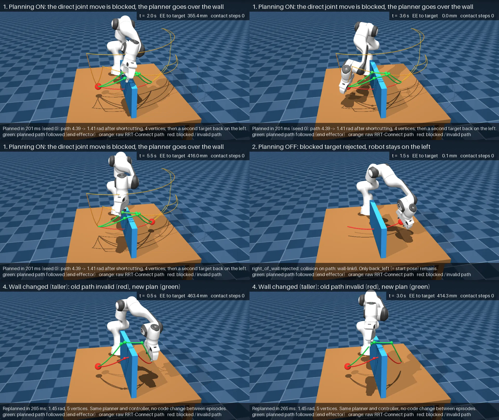
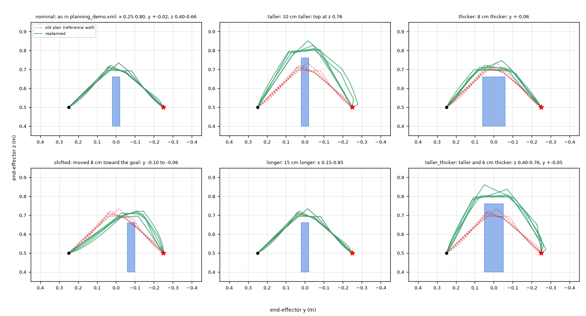

# Robotics Lab v0.5.1: collision-aware reaching in MuJoCo, a short research brief

Branch `feature/v0.5.1-robustness-demo` (from v0.5 `ce3e907`). This adds no new planning
method; v0.5 (joint-space RRT-Connect) is unchanged. v0.5.1 adds three things:
- a verification of v0.5;
- a rendered demo video;
- a controlled experiment in which the obstacle changes between episodes.

The full v0.5 report is [`v0.5-results.md`](v0.5-results.md).

## In one paragraph

A torque-controlled Franka Panda in MuJoCo must move its hand from one side of a wall to
the other. The straight joint-space move would sweep the hand through the wall. A
sampling-based planner (RRT-Connect plus shortcutting, 20 mm clearance target) finds a route
over the wall in about 0.2–0.5 s, before motion starts. The existing torque MPC or
computed-torque controller then executes the route through MuJoCo physics.

We changed the wall's height, thickness, position and length between episodes, with the new
geometry known at each episode's start:
- **Replanning:** succeeded in 30/30 episodes.
- **Execution:** 60/60 (two controllers) reached the target within 0.085 mm with zero contacts.
- **Old plans:** in the 4 variants whose change matters, the previous episode's plan was invalid
  in 20/20 cases. It would have penetrated the wall by 3–67 mm.

While measuring clearance we found that MuJoCo 3.16's box-box collision routine misreports
distances inside the contact margin. As a result the v0.5 "≥ 15 mm" clearance certificate
does not hold for the gripper's box-shaped fingertip pads (§4.4).



## 1. System

```
config (task, planning, environment_overrides)
   │
   ▼  once per episode, before motion
SimulationEngine: environment XML + MjSpec overrides (wall size/pos) + Panda (torque actuators)
MotionPlanner (planning/): IK postures -> RRT-Connect -> shortcut -> path_valid
   CollisionChecker: private MjModel copy, mj_collision with 20 mm margin on obstacles,
                     edges sampled so no robot point moves > 10 mm between checks
   │  joint-space path (3-7 vertices)
   ▼
JointTargetTask: rest-to-rest min-jerk segments, time-scaled to velocity/accel/jerk/torque limits (v0.4)
   │  q_ref(t), qd_ref(t), qdd_ref(t)
   ▼  every 2 ms
TorqueMPC (OSQP, 50 Hz, 0.5 s horizon)  or  computed-torque control (500 Hz)
   │  joint torques
   ▼
mj_step (MuJoCo 3.16, implicitfast)  -- the only source of motion; contacts are real
```

- **Where geometry comes from.** The planner sees exactly the geometry of the simulated
  scene: it copies the compiled model. Nothing is perceived; the geometry is given.
- **When planning happens.** The plan is made once, when the task is built. The controllers
  never see obstacles; safety relies on tracking the planned reference.
- **What happens on failure.** The target is rejected with a reason. The straight move is
  never silently substituted.

## 2. Demo video

`results/video/v0.5.1_demo.webp` is 31 s at 25 fps, 960×540, real-time playback. It is
rendered offscreen from the same `SimulationRunner` used everywhere else. Four title cards
introduce three clips:

| clip | what is shown | measured in that clip |
|---|---|---|
| 1. planning on | The blocked direct move is drawn in red, the raw RRT path in orange and the executed shortcut path in green. The arm goes over the wall, then returns to a second target. | Planning 201 ms; path 4.39 -> 1.41 rad; 0 contact steps; final error 0.05 mm |
| 2. planning off | The v0.3/v0.4 straight-path check rejects the target (`collision on path: wall-link6`). The robot stays on the left. | 0 contact steps |
| 4. new episode, wall 10 cm taller | The previous plan (red) is re-checked against the new wall and rejected (`vertex 1: collision: wall-hand`). The robot replans (green) and executes. | Replanning 265 ms; 0 contact steps; final error 0.01 mm |

An optional clip 3 (`--include-unsafe`) shows planning off with the path and torque checks
deliberately disabled, so the arm drives into the wall. It is opt-in and labelled as an
unsafe baseline. Rendering takes about 2 minutes.

The WebP plays in any browser. For an MP4, add `--frames-dir frames` and convert with
`ffmpeg -framerate 25 -i frames/frame_%05d.png -pix_fmt yuv420p demo.mp4` if ffmpeg is
installed. Alternatively, record the live viewer
(`main.py --config configs\planning_demo.yaml`) with Windows' Xbox Game Bar (Win+Alt+R)
or OBS.

## 3. Wall-robustness experiment

**Protocol** (`configs/robustness_wall.yaml`, `simulation/robustness.py`):
- **Episodes.** There are 6 wall variants × 5 seeds (0–4) = 30 episodes. Start, target
  (0.45, −0.25, 0.50) m, planner settings and controllers are identical in every episode.
- **Changing the wall.** The wall is changed in code through MjSpec. The XML file is untouched.
- **Old plan.** The plan from the nominal wall with the same seed is re-checked against the new
  geometry, and its distance to the wall is measured. It is never executed.
- **Replan and execute.** A fresh planner plans in the new scene. Torque MPC and
  computed-torque control each execute that plan in MuJoCo, giving 60 executions.
- **Success** means a final end-effector error ≤ 1 mm and no robot contact at any physics step.
- **Clearance** is measured two ways:
  - "Contact": MuJoCo `contact.dist`, as in v0.5.
  - "Exact": `mj_geomDistance` (GJK) over every collidable robot/obstacle pair.

  §4.4 explains why both are reported.

**Results:** every episode is listed in
[`v0.5.1-robustness-planning-runs.csv`](v0.5.1-robustness-planning-runs.csv) and
[`v0.5.1-robustness-execution-runs.csv`](v0.5.1-robustness-execution-runs.csv).

| variant | change | old plan invalid | old plan min. distance (mm) | replanned | planning time median / max (s) | path length mean [min–max] (rad) | executed min. clearance, exact (mm) | MPC / CTC success |
|---|---|---|---|---|---|---|---|---|
| nominal | none (x 0.25–0.80, y ±0.02, z 0.40–0.66) | 0/5 | +20.3 | 5/5 | 0.233 / 0.288 | 1.42 [1.32–1.53] | 20.3 | 5/5 / 5/5 |
| taller | top 0.66 -> 0.76 m | **5/5** | **−42.1** | 5/5 | 0.267 / 0.283 | 1.92 [1.45–2.21] | 20.2 | 5/5 / 5/5 |
| thicker | y ±0.02 -> ±0.06 m | **5/5** | **−13.4** | 5/5 | 0.232 / 0.469 | 1.66 [1.16–2.36] | 19.9 | 5/5 / 5/5 |
| shifted | moved 8 cm toward the goal | **5/5** | **−48.4** | 5/5 | 0.252 / 0.363 | 1.92 [1.67–2.28] | 20.1 | 5/5 / 5/5 |
| longer | x 0.25–0.80 -> 0.15–0.85 m | 0/5 | +20.3 | 5/5 | 0.363 / 0.445 | 1.42 [1.32–1.53] | 20.3 | 5/5 / 5/5 |
| taller_thicker | z to 0.76, y ±0.05 | **5/5** | **−67.0** | 5/5 | 0.345 / 0.383 | 1.97 [1.65–2.52] | 20.0 | 5/5 / 5/5 |

- Old-plan distance is the exact value; negative means the old path penetrates the new wall.
- Planning time covers IK, RRT-Connect and shortcutting, in Python wall-clock time.
- Contact steps were 0 in all 60 executions.



## 4. Verified findings

### 4.1 Replanning with known geometry works across the tested variants

- **Planning:** 30/30 episodes found a path, with a median time of 0.23–0.36 s per variant
  and a maximum of 0.47 s. Each successful path was re-validated by a freshly built checker
  (30/30).
- **Execution:** 60/60 executions succeeded, with 0 contact steps, no joint-limit or velocity
  violations, and a maximum final error of 0.085 mm.
- **Path length:** paths get longer when the wall is taller or thicker (mean 1.42 -> 1.92–1.97
  rad). Individual seeds vary widely (thicker: 1.16–2.36 rad).

### 4.2 Old plans are unsafe exactly when the change matters

- **Variants that move the wall into the swept region** (taller, thicker, shifted,
  taller_thicker): the old plan was invalid in 20/20 episodes. Its exact minimum distance was
  −3 to −67 mm, i.e. it would penetrate the wall.
- **Changes away from the path** (nominal; longer, which extends the wall toward the robot
  base): the old plan stayed valid in 10/10. For the longer wall, the replanned paths are
  identical to the nominal ones.

Re-checking cached plans against the current scene therefore costs one path validation and is
necessary. Reusing plans blindly would have driven into the wall in two thirds of these
episodes.

### 4.3 Controllers: same paths, both succeed, different tracking

Both controllers executed the identical 30 references. The final error is set by the IK
tolerance, not the controller: both controllers reach the planned goal configuration, and the
remaining 0.012–0.085 mm is the IK residual.

| | torque MPC (50 Hz) | computed-torque (500 Hz) |
|---|---|---|
| success | 30/30 | 30/30 |
| max tracking error | 0.044 mrad | 0.272 mrad |
| RMS tracking error (worst run) | 3.4e-6 rad | 6.8e-5 rad |
| max final EE error | 0.085 mm | 0.085 mm |
| MPC fallbacks | 0 | n/a |
| MPC deadline overruns (> 20 ms update) | 17 over 30 runs | n/a |

The deadline overruns are wall-clock effects of a loaded laptop (about 8 GB RAM). The same
experiment's first run, with identical motion, had 3. They are not a property of the
controller and did not affect tracking.

### 4.4 MuJoCo box-box contacts misreport distance inside the margin (affects the v0.5 certificate)

- **Claim under test.** v0.5 implements a 20 mm clearance by setting a contact margin on
  obstacles and treating any contact as "too close". With edges sampled every ≤ 10 mm of robot
  motion, it claimed at least 15 mm everywhere on a checked path.
- **Observation.** In episode thicker/seed 3, the contact-based monitor reported 14.98 mm
  during execution, below the claim. The cause was a measurement problem, not a near
  collision. For the fingertip pad, which is a box, against the box-shaped wall:

  | measure | distance |
  |---|---|
  | MuJoCo `contact.dist` | 14.64 mm |
  | `mj_geomDistance` (GJK) | 20.0 mm |
  | independent vertex-to-box computation | 20.0 mm |

  At a neighbouring sample the error had the opposite sign. The checker accepted a
  configuration whose true distance was 19.94 mm, because no contact was generated.
- **Isolation.** Two boxes in an otherwise empty MuJoCo 3.16 model: a fingertip-pad-sized box
  near a wall-sized box, 20 mm margin, 20,000 random poses.
  - In 260 of 14,568 poses within 30 mm, the true distance was < 20 mm but **no contact** was
    generated. The closest such pose was 1.25 mm from the wall.
  - Where contacts are generated, `contact.dist` errs by −4.8 to +6.7 mm.
  - Actual penetration was always detected: 13,881 of 13,881 penetrating poses.
- **Consequence.** For robot/environment pairs that are both boxes — the Panda's fingertip pads
  against the wall or table top — the v0.5 clearance is not guaranteed. Only
  non-penetration at the samples is reliable. Most of the Panda's collision geometry consists
  of meshes and is not affected; the v0.5 random-configuration ground-truth test passes.
- **Observed margins.** In all 60 executions here, the exact minimum clearance was 19.9 mm or
  more. In this experiment the contact-based numbers were mostly *pessimistic*: v0.5's
  reported "16.2 mm" corresponds to 20.3 mm exact.
- **Status.** Not fixed in v0.5.1, because the planner was out of scope. It is pinned by
  `test_box_box_margin_contact_is_generated_inside_the_margin`, which is marked as an expected
  failure and errors loudly once MuJoCo or the checker changes. A likely fix is to compute
  box-box robot/obstacle pairs with `mj_geomDistance` in the checker; that needs its own
  validation.

## 5. Limitations (what this does *not* show)

- **No perception, no online replanning.** Obstacle geometry is exact and known at the start
  of each episode. Nothing changes during motion.
- **One task family.** There is one start, one target and one obstacle type (a box wall).
  The 6 variants × 5 seeds sample variation in a narrow neighbourhood. They show robustness to
  these changes, not generality.
- **Clearance is not continuously guaranteed.** Checking is discrete (edge samples), and the
  box-box issue in §4.4 applies. Self-collision is checked only at samples.
- **Simulation only.** MuJoCo's collision geometry is convex hulls of the Panda meshes, and
  the plant is the controllers' exact model. There is no model mismatch, noise or latency in
  this experiment (v0.4 studied those separately).
- **Path quality.** RRT-Connect plus shortcutting is not optimal; lengths vary up to 2× across
  seeds. Rest-to-rest via points make the motion slower than a blended trajectory.
- **Small samples.** 5 seeds per variant. The 0/30 planning failures and 0/60 execution
  failures do not rule out failures at rates of a few percent.

## 6. Possible research directions

These are suggestions for discussion, not results.

- **Perception in the loop.** Replace known geometry with geometry estimated from depth images
  rendered by MuJoCo, and measure how estimation error must be absorbed by the clearance.
- **Replanning during motion.** Move the wall mid-episode and compare a stop-and-replan
  strategy with reactive layers, e.g. MPC with obstacle constraints.
- **Learned or amortized planning.** Use the planner as an expert to generate trajectories for
  imitation learning or learned samplers. The evaluation harness (episodes, seeds, exact
  clearance, contacts) can be reused.
- **Tool use.** Treat a grasped tool as part of the robot's collision geometry; geometry
  changes would then come from the tool rather than the scene.
- **Collision-checking reliability.** The §4.4 finding suggests auditing distance queries per
  primitive pair before relying on margins in any simulator-based planner.

## 7. Reproduction (Windows PowerShell, repo root)

```powershell
.\.venv\Scripts\python.exe -m pytest tests -q                                    # all tests (~2.5 min)
.\.venv\Scripts\python.exe -m pytest tests\test_robustness.py -v                 # v0.5.1 tests
.\.venv\Scripts\python.exe main.py --config configs\planning_demo.yaml --headless                # v0.5 demo, planned
.\.venv\Scripts\python.exe main.py --config configs\planning_demo.yaml --no-planning --headless  # planning off
.\.venv\Scripts\python.exe main.py --config configs\planning_demo.yaml                           # interactive viewer
.\.venv\Scripts\python.exe tools\render_demo_video.py                            # video -> results\video\v0.5.1_demo.webp
.\.venv\Scripts\python.exe tools\render_demo_video.py --include-unsafe           # + unsafe baseline clip
.\.venv\Scripts\python.exe robustness_experiment.py --output results\robustness_v051   # section 3 (sequential)
.\.venv\Scripts\python.exe robustness_experiment.py --no-execution               # planning + old-plan checks only
```

- **Determinism.** Seeds are fixed. Planning is deterministic for a given seed while no time
  budget is hit: the planning-only and in-runner plans had identical lengths in all 60 cases.
  Timing numbers depend on machine load.
- **Versions.** Python 3.13, MuJoCo 3.16.0, Windows 11, about 8 GB RAM. No packages were added.
- **Box-box isolation.** The §4.4 two-box result is pinned by the xfail test
  `test_box_box_margin_contact_is_generated_inside_the_margin`; the 20,000-pose survey itself
  was a scratch script and is not in the repository.

Data in this directory:
- `v0.5.1-robustness-planning-runs.csv` (30 episodes)
- `v0.5.1-robustness-execution-runs.csv` (60 runs)
- `v0.5.1-robustness-summary.csv`
- figures `figures/v0.5.1_*.png`

v0.5 results and earlier reports are unchanged.
