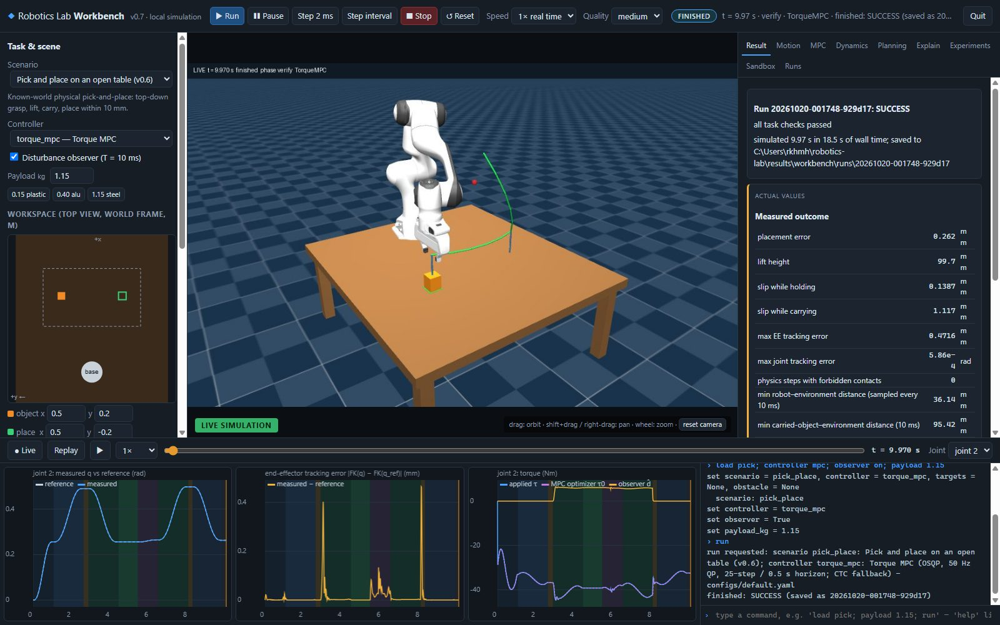
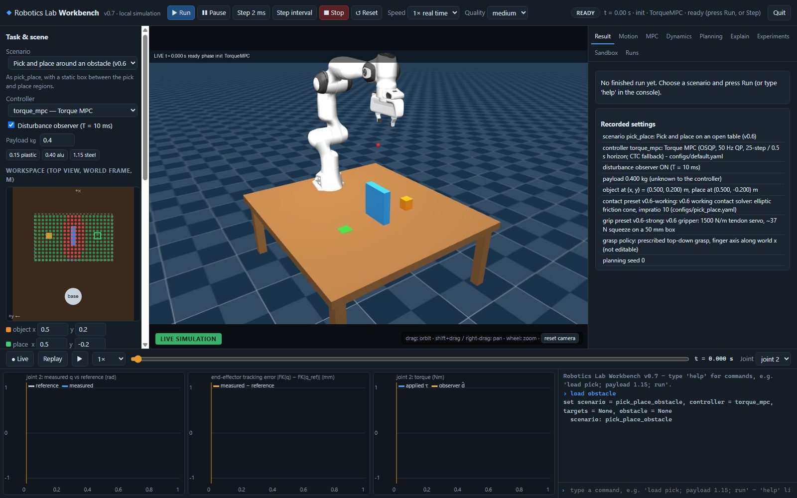
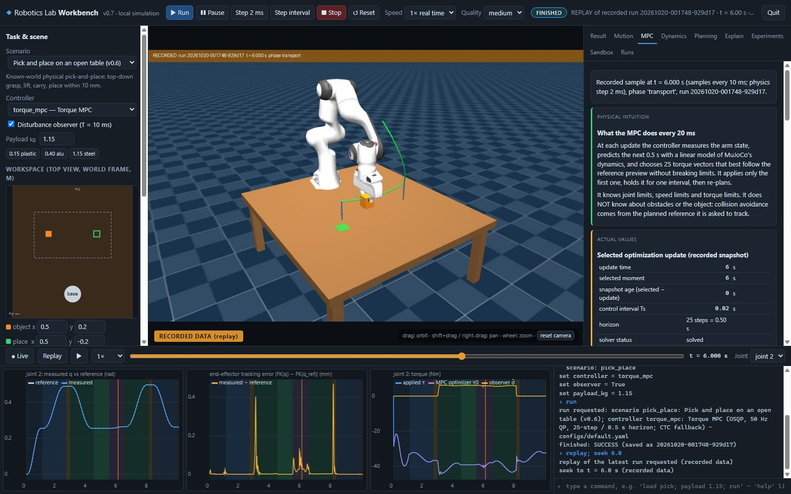

# Robotics Lab Workbench — user guide (v0.7)

A local browser application for running the project's simulations, watching them, replaying them, and
connecting what the robot does to the mathematics behind it. It is a front end: every run goes through the
same planners, controllers, physics and success checks as the command-line tools (`main.py`, `pick_place.py`).

## Start and stop

```powershell
.\.venv\Scripts\python.exe workbench.py          # opens http://127.0.0.1:8765 in your browser
Workbench.bat                                    # the same, double-clickable from Explorer
.\.venv\Scripts\python.exe workbench.py --port 8800 --no-browser
```

Everything runs on your computer (127.0.0.1 only); no network or paid service is used. Close the workbench with
**Quit** (top right) or Ctrl+C in its window. Either stops the simulation, releases the renderer and ends the
process. Closing only the browser tab leaves the server running; open the address again to continue.

## Screen layout



| Area | What it is for |
|---|---|
| **Top bar** | Run, Pause/Resume, Step 2 ms (one physics step), Step interval (one controller interval: 20 ms for torque MPC, 2 ms for CTC/PID), Stop, Reset, live speed (0.25×–2× real time or max), display quality, run status, Quit. |
| **Left: Task & scene** | Scenario, controller, observer, payload, a top-down workspace editor (drag the orange object and the green target), obstacle size/position, contact and gripper presets, planning seed, force pulse, measurement noise. Changes apply to the **next** run or reset, never to a run in progress. Below: the resolved settings exactly as the backend will use them. |
| **Centre: viewport** | The MuJoCo render of the live simulation (green badge LIVE SIMULATION) or of recorded data (orange badge RECORDED DATA). Drag to orbit, Shift-drag or right-drag to pan, wheel to zoom, "reset camera". Green curve: planned hand path; blue: straight approach/lift lines; red spheres: reach targets; magenta arrow: an active force pulse. |
| **Right: inspector** | Result, Motion, MPC, Dynamics, Planning, Explain, Experiments, Sandbox, Runs (see below). |
| **Bottom: timeline** | Live / Replay, play/pause and speed of the replay, the time scrubber, and the joint shown in the plots. |
| **Bottom: plots** | Selected joint: measured vs reference angle; end-effector tracking error; applied torque, the MPC optimizer's first torque and the observer's disturbance estimate. Coloured bands are the task phases. Click a plot to jump the replay to that time. |
| **Bottom right: console** | Typed commands (below). ↑/↓ recall history. |

**Display vs physics.** The physics step is always 2 ms. Speed and quality only change how often and how
finely frames are drawn. Rendering is limited so that it takes at most about a third of the simulation
worker's time; at "max" speed the viewport updates about 5 times per second.

## Scenarios and what is supported

| Scenario | Task | Controllers | Editable |
|---|---|---|---|
| Reach over a wall | v0.5 planning demo: Cartesian targets on both sides of a wall | torque MPC, CTC, joint PID, servo MPC | targets, wall, seed, force pulse, noise |
| Reach targets above an empty table | planned reaching without obstacles | same | targets, seed, force pulse, noise |
| Pick and place (open table) | v0.6 physical pick-and-place | torque MPC, CTC | payload, object and target position, contact and gripper presets, seed, force pulse, noise |
| Pick and place around an obstacle | as above, with a static box | torque MPC, CTC | as above, plus obstacle |

While no run is active, edits rebuild the scene in the viewport as a preview (once after a burst of edits);
during a run they only change the pending settings. **Scan workspace** (pick-and-place, or the command `scan`)
classifies object positions on a 30 mm grid for the top-down grasp on a private model: green = IK solution
found and collision checks passed, red = collision-blocked, grey = the IK search did not find a solution (not a
proof of unreachability; planning can still fail at green points).



Unsupported combinations are refused with a reason. For example, pick-and-place with the position-servo
controllers was never validated. The grasp is the prescribed top-down grasp with the finger axis along
world x; there is no grasp-orientation control because the backend does not support one. **Check** (or the
command `check`) runs a pre-flight test: validation, an IK search for the key poses and a collision test of
the start configuration. "Search did not find a solution" is not a proof that the pose is unreachable.

Coordinates are in metres in the world frame: origin on the floor below the robot base, x forward, y to the
left, z up. The table top is at z = 0.40 m.

## Commands

Type `help` for the full list. Commands change the same settings as the forms and show what they resolved
to; several can be joined with `;`.

```
load wall | table | pick | obstacle        controller mpc | ctc | pid | servo-mpc      observer on | off
payload 0.40        object 0.50 0.20       place 0.50 -0.20       target 0.45 0.25 0.6 (target add ...)
obstacle pos 0.5 0 0.49     obstacle size 0.08 0.02 0.09     obstacle default
contact v0.6-working | mujoco-default      grip strong | weak      seed 3
force hand 20 dir 0 0 -1 at 3 for 0.5     force off      noise 0.0005 0.005 seed 7      noise off
check     scan     run     pause     resume     step [n]     step interval     stop     reset     speed 2 | max
replay [run_id]     seek 6.0     play [speed]     live
show mpc | motion | dynamics | planning | explain | sandbox | experiments | runs | result
explain [t]       compare payload | observer | controllers | contact | grip | force | noise
```

Parsing is deterministic and local: no language model, no `eval`, no shell. Invalid input gets a specific
message, e.g. `payload 9` gives "payload 9.0 kg outside the supported 0.05–2.0 kg".

## Recording and replay

Every run is recorded and saved automatically to `results/workbench/runs/<run_id>/`:
- `telemetry.npz`: every 10 ms, the measured and reference arm state, applied commands, object pose, gripper,
  phase, controller/fallback, contacts, force and clearance;
- `mpc_snapshots.json`: every torque-MPC update;
- `events.json`;
- `meta.json`: the resolved configuration, code commit and library versions;
- `result.json`.

**Replay** (or the Runs tab) opens a recording. The viewport then shows recorded poses rebuilt in a separate
model, with an orange "RECORDED" label; the live plant is never touched. Scrub, play, or click a plot. The
viewport, plots, inspectors and Explain panel all follow the selected time. Replay shows measured motion;
the reference is drawn only where it is labelled as the reference.

## The inspectors (physical intuition → equation → actual values → observed consequence)

Each card is labelled with what it is. Values marked "recorded" come from the run. "Calculation" values are
computed from recorded values on a private copy of the model. Anything not recorded is shown as
"unavailable".

**Motion.** Measured q, q̇ and their references for every joint; the hand position from forward kinematics of
the measured and of the reference joints. A local-approximation check: for the selected joint, Δq = 0.01 rad
predicted with the Jacobian (Δp ≈ J Δq) against forward kinematics of the perturbed pose on a scratch model.
The live robot does not move.

**MPC** (torque-MPC runs). Shows the update at or before the selected time, together with its age:
- timing and solver status: control interval, horizon, solver status, iterations, residuals, solve and
  update time;
- prediction plot for the selected joint, separating:
  - the past measured motion;
  - the purple predicted knots;
  - the reference preview;
  - the motion measured afterwards;
- the planned torque sequence;
- the implemented objective with its actual weights, split into tracking, effort, torque change and slack;
- the constant the solver omits, so that the totals agree (tested);
- hard and soft constraints and their smallest margins over the horizon;
- the command path: optimizer torque (Nm and normalized), the observer's feedthrough correction, the clipped
  command and the torque the motors produced.

The MPC knows joint, speed and torque limits only. It does not know about obstacles.



**Dynamics.** M(q) q̈ + h(q, q̇) = τ + d, with the following values for the selected joint:
- from the nominal model: the inertia diagonal, gravity and bias torques;
- from the recording:
  - the applied torque;
  - the observer's estimate d̂;
  - a finite-difference acceleration;
- calculations:
  - the approximate disturbance residual (from 10 ms differences, so it is noisy);
  - the torque the object's weight would exert if rigidly held, labelled as simulation truth that the
    controller does not have.

Plant truth (true payload) and the controller's model (contact-free, nominal object) are listed separately.

**Planning.** The paths used (planner paths and straight lines). It explains why a geometric path is not a
trajectory and states the conditional 15 mm bound and its assumptions. Three outcomes are kept separate:
- task completion;
- forbidden contacts (checked every 2 ms);
- measured distances (every 10 ms), compared with the requested 20 mm.

These are finite samples, not continuous guarantees.

**Explain.** A deterministic paragraph for the selected moment, built from recorded values:
- phase and goal;
- measured-vs-reference gap;
- active controller;
- latest MPC update;
- observer;
- torque-limit use;
- joint-limit margin;
- clearance;
- object;
- force;
- forbidden contacts;
- recent events.

**Sandbox.** A separate one-joint MPC (inertia, torque limit, horizon, weights). It is clearly labelled as an
educational model, solved by the same `TorqueMPCController` code and checked against a closed-form solution.
It shows accelerate-then-brake and the effect of a torque limit.

## Guided experiments

The Experiments tab, or `compare <name>`. Each states:
- the question;
- a prediction written beforehand;
- what is fixed and what changes.

It then runs matched simulations one after another at maximum speed and saves every run. The explanation is
generated from the recorded metrics afterwards and lists any failure first. Results:
`results/workbench/experiments/<id>.json`. Results of one session (2026-10-20, one run per condition):

| Experiment | Recorded outcome |
|---|---|
| payload (CTC, no observer) | max hand error while carrying 0.55 mm at 0.15 kg vs 4.22 mm at 1.15 kg; placement error 0.45 vs 2.87 mm |
| observer (CTC, 1.15 kg) | 4.22 → 0.21 mm while carrying; placement 2.87 → 0.26 mm |
| controllers (observer on, 1.15 kg) | carrying error CTC 0.21 vs MPC 0.13 mm; placement equal (0.26 mm); MPC run 1.8× the wall time |
| contact (CTC + observer, 1.15 kg) | v0.6-working: success; MuJoCo default cone: **failure** at lower (block slipped 10 mm in the hand) |
| grip (1.0 kg) | v0.6 gripper: success; Menagerie gains: **failure** at lift (object rose −0.1 mm) |
| force (30 N down on the hand for 1 s, reach, CTC) | deflection 11.0 mm without vs 1.0 mm with the observer (0.02 mm at the end of the push) |
| noise (same push, σq = 0.5 mrad, σq̇ = 5 mrad/s) | the observer still rejects the push (1.1 mm), but the high-frequency torque rises from 0.69 to 1.43 Nm RMS: the price of differentiating noisy measurements |

These are single exploratory runs at one object pose and seed. They do not inherit the v0.6 study's success
claims, and the gripper/contact settings are simulation choices that were never validated on hardware.

## Start here: a 20-minute learning path

1. **(2 min) Watch a planned reach.** Type `load wall; controller mpc; run`. The green curve is the planned
   hand path over the wall. When it finishes, the Result tab shows the error at each target.
2. **(3 min) Pause and step.** Press Run again, then Pause during a move. Press *Step 2 ms* a few times (one
   physics step each), then *Step interval* (one 20 ms MPC interval). Watch t in the status bar.
3. **(3 min) Motion.** With the run paused, open **Motion**: compare measured and reference joints, then
   choose another joint at the bottom right and read the Jacobian check. The prediction J Δq misses forward
   kinematics only by a second-order term.
4. **(4 min) One MPC decision.** Press *Replay*, drag the scrubber to the middle of a move and open **MPC**:
   - the purple dots are what the optimizer predicted;
   - green is what then happened;
   - read the objective terms and which constraints are hard.
5. **(4 min) A payload the controller does not know.** Type `load pick; controller ctc; observer off;
   payload 1.15; run`. In the plots, the hand error rises while the block is carried (green bands). Open
   **Dynamics** during the hold phase: the object's weight torque is listed as simulation truth, and there
   is no estimate.
6. **(2 min) Let the observer find it.** Type `compare observer` and wait for both runs. The Experiments tab
   explains the difference from the recorded numbers. Replay the "observer ON" run and look at d̂ in the
   torque plot.
7. **(2 min) Explain a moment.** Pick any time on the scrubber and open **Explain**: every sentence is built
   from recorded values.
8. **(optional) Sandbox.** Press Simulate with the default 1 Nm limit, then raise it to 10 Nm: with the low limit the push saturates,
   braking starts later, and the move takes longer.

## Python API

```python
from workbench import RunRequest, run_to_end, Recording, inspect

req = RunRequest(scenario="pick_place", controller="torque_mpc", observer=True, payload_kg=1.15)
result, rec = run_to_end(req)                  # headless, saved under results/workbench/runs/
print(result.outcome, result.metrics["placement_error_mm"])
print(inspect.explain(rec, 6.0)["lines"])
```

## Limits and assumptions

- **Robot and world:**
  - The Panda is the only validated robot. Scenarios, poses, bounds and the grasp policy are
    Panda-specific; the registry is an extension boundary, not support for other robots.
  - Known world: object pose and obstacles come from the simulator (ground truth). There is no perception,
    no reactive replanning, no moving obstacles and no hardware interface.
- **Noise and forces:** measurement noise is applied only to the arm controller's joint observations. The
  supervisor's decisions, the object pose and all metrics use the true simulated state. Force pulses act on
  the plant only; the controllers never receive them.
- **Not implemented:** actuation-delay presets (optional stretch) and joint-space goal/preview controls.
- **Rendering:** offscreen MuJoCo rendering is CPU-heavy on this laptop (about 11 ms per 960 × 600 frame
  without shadows, about 55 ms with them). The "high" quality preset turns shadows on.
