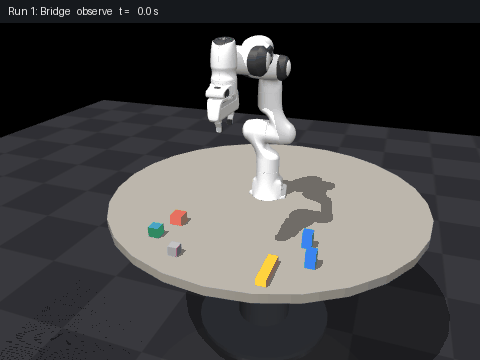

# Assembly runs (24 Oct 2026)

Total simulated robot time: **129.8 s** (2.16 min) in 3 runs, 8/8 moves succeeded. Objects located with: the simulated RGB-D camera.

Placement error: mean 0.63 mm, max 1.36 mm (pass limit 15 mm).
Camera localization error (before each pick): mean 1.07 mm, max 2.33 mm.

| Run | Scenario | Result | Simulated time |
|---|---|---|---|
| 1 | Assemble a bridge: two pillars, then a beam across them | succeeded | 67.9 s |
| 2 | Assemble a tower of three blocks | succeeded | 47.4 s |
| 3 | Crown the bridge: move the tower's top block onto the beam | succeeded | 14.4 s |

| Run | Move | Object | Result | Placement error | Tilt | Camera error | Time |
|---|---|---|---|---|---|---|---|
| 1 | Clear the build spot: move Beam | Beam | done | 0.7 mm | 0.0 deg | 0.3 mm | 17.3 s |
| 1 | Place Pillar A (left side of the bridge) | Pillar A | done | 1.4 mm | 0.0 deg | 1.6 mm | 16.6 s |
| 1 | Place Pillar B (right side of the bridge) | Pillar B | done | 0.6 mm | 0.0 deg | 1.7 mm | 16.7 s |
| 1 | Lay Beam across the pillars | Beam | done | 1.1 mm | 0.0 deg | 2.3 mm | 17.2 s |
| 2 | Put Base block on the build spot | Base block | done | 0.4 mm | 0.0 deg | 0.3 mm | 16.1 s |
| 2 | Stack Middle block on Base block | Middle block | done | 0.1 mm | 0.0 deg | 1.0 mm | 15.9 s |
| 2 | Stack Top block on Middle block | Top block | done | 0.4 mm | 0.0 deg | 0.6 mm | 15.4 s |
| 3 | Put Top block on Beam | Top block | done | 0.5 mm | 0.0 deg | 0.6 mm | 14.4 s |

Snapshots after each run: [run 1](after_run1_bridge.png), [run 2](after_run2_tower.png), [run 3](after_run3_crown.png)

Files: `moves.csv` (one row per move), `runs.json` (full run records with phase timings and joint traces).
